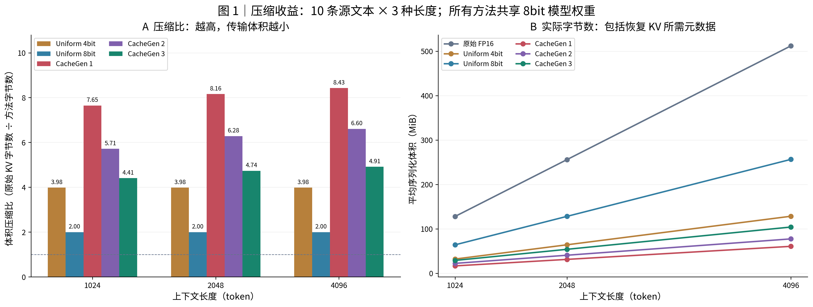
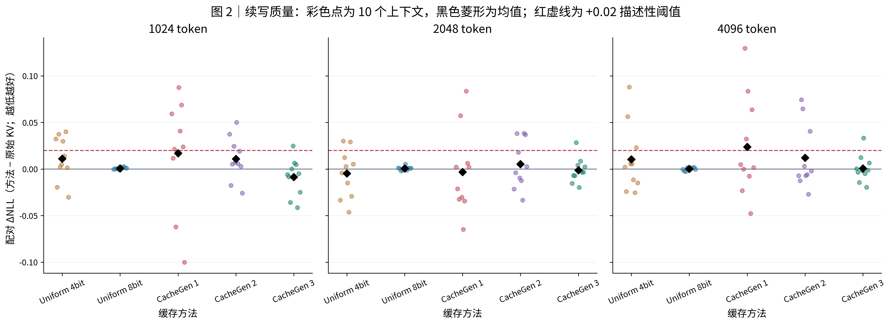
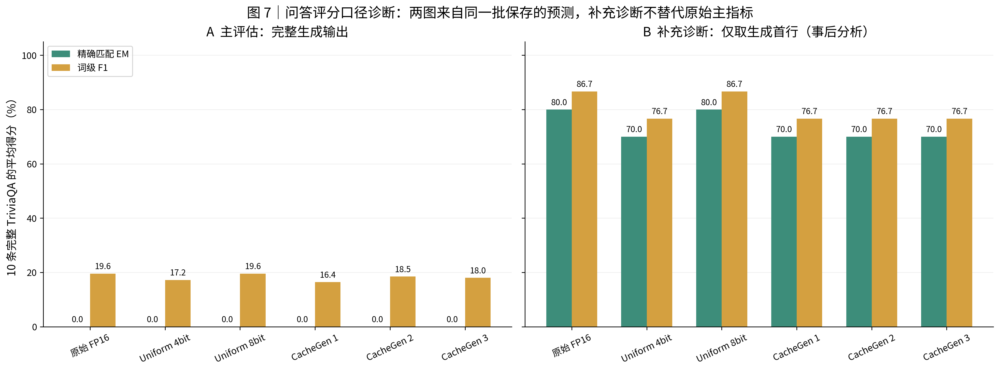
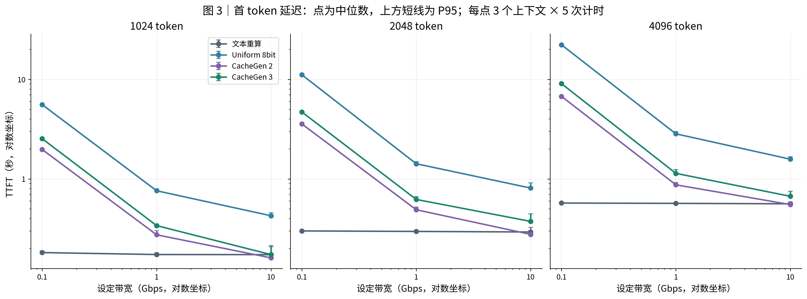
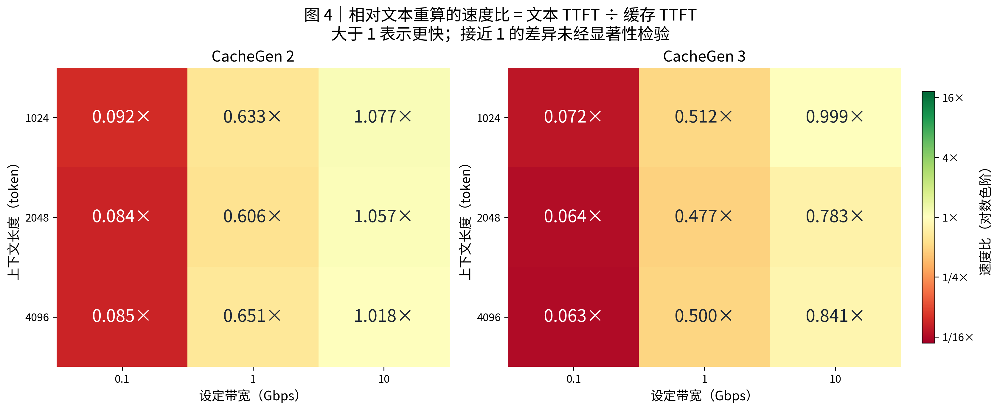
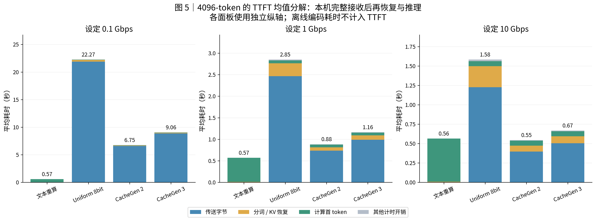
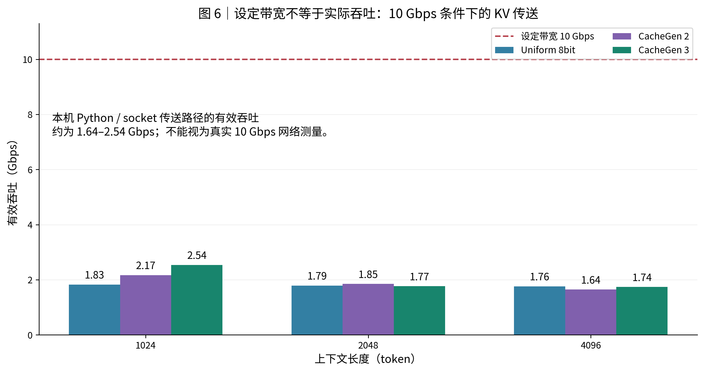

# CacheGen 小规模复现实验报告

**实验模型：Mistral-7B｜运行设备：RTX 4090 D｜批次：`20261024T064543Z`**

实验时间：**2026-10-24 14:45:47–15:20:30（北京时间）**，总耗时约 **34 分 43 秒**。本报告基于已经完成的测量记录生成，未重新运行模型实验。

## 1. 主要结论

本轮完成了作者仓库实现的 **KV 压缩、质量评估和单机传输 TTFT** 实验，包含 30 个自然文本条件、10 个完整问答和 540 次正式计时。结论应限定在当前模型、数据子集和传送实现内。

- **压缩收益明确。** CacheGen 3 在 1024/2048/4096 token 下，相对原始 FP16 序列化缓存的体积压缩比分别为 **4.408× / 4.735× / 4.912×**。CacheGen 2 为 **5.714× / 6.284× / 6.605×**，压缩更强。
- **续写质量变化较小，但不能据此声称整体无损。** CacheGen 3 的平均配对 ΔNLL 分别为 **−0.00851 / −0.00120 / +0.00073**。每种长度仅 10 个上下文；负差值不能解释为已经证明模型质量提高。
- **TTFT 优势取决于对照基线。** CacheGen 3 在全部 9 个长度/带宽组合中快于 Uniform 8bit，中位 TTFT 速度比为 **2.16–2.49×**；相比文本重算则没有中位 TTFT 优势。CacheGen 2 仅在设定 10 Gbps 的 3 个组合中略快于文本，速度比约 **1.018–1.077×**，未检验统计显著性。
- **问答主指标存在输出格式影响。** 按完整生成输出评分，所有方法 EM 均为 0。对同一批预测取首行做事后诊断，原始 KV 的 EM/F1 为 **80.0%/86.7%**，CacheGen 3 为 **70.0%/76.7%**；该补充诊断显示个别答案有损失，不替代预设主指标。
- **未获得联合质量门槛的支持。** 原始 KV 的完整输出 EM 正确题数为 0，预设的“保留至少 90% 原始正确题”指标不可计算。归档 CSV 中 `passes_descriptive_threshold=False` 应解读为“没有足够证据通过联合门槛”，并非所有压缩方法都已被证实劣于原始 KV。

## 2. 复现目标与论文对应关系

参考论文为 *CacheGen: KV Cache Compression and Streaming for Fast Large Language Model Serving*，SIGCOMM 2024。作者系统围绕 KV 压缩和网络加载减少上下文准备延迟；本轮验证其中适合现有单卡配置的两组核心关系。

| 论文研究内容 | 本轮覆盖方式与差异 |
| --- | --- |
| KV 体积—质量关系 | 使用真实 Mistral-7B KV，比较六种方法；自然文本 10 条，最长 4096 token |
| 长上下文/多模型评估 | 本轮为单一 7B 模型、短上下文子集；不等同于论文多模型、长上下文规模 |
| anchor/delta 编码 | 当前作者仓库编码路径缺少该阶段；本轮沿用仓库实现 |
| KV 流式加载 | 在本机 socket 传送真实字节，完整接收后解码；没有跨服务器传输或传输—解码重叠 |
| 带宽自适应、多请求并发 | 不在本轮两组核心实验范围内 |
| 下游问答评分 | 主指标按完整生成输出评分，与作者 tqa 首行评分存在差异；本报告另做首行补充诊断 |

因此，本文定位为 **作者仓库实现的小规模实测复现**，不将本轮压缩比、带宽设定或单机耗时直接等同于论文完整系统的结果。模型 8bit 权重与 FP16 KV 是不同的精度口径；所有方法共享相同模型权重。

## 3. 运行环境与固定版本

| 项目 | 本批次配置 |
| --- | --- |
| GPU | NVIDIA GeForce RTX 4090 D，标称 24GB 显存；计算能力 8.9 |
| 容器资源 | 内存上限 30 GiB；CPU 配额相当于 10 核 |
| 系统 | Linux-5.15.0-25-generic-x86_64-with-glibc2.35 |
| Python | 3.10.12 |
| PyTorch / CUDA runtime | 2.3.1+cu121 / 12.1 |
| CUDA Toolkit | 项目内 CUDA 12.1，nvcc 12.1.105 |
| Transformers / NumPy | 4.42.3 / 1.26.4 |
| FastChat / LMCache / torchac | 0.2.36 / 0.1 / 0.9.3 |
| 注意力实现 | MistralSdpaAttention（SDPA） |
| 模型权重 | FastChat groupwise 8bit；所有对照共享同一模型 |
| KV 数据类型 | FP16；与模型权重量化分别记录 |
| 推理设置 | batch size 1，贪心生成，种子 0，PyTorch / OpenMP 线程数 8 |
| 显存峰值 | PyTorch 分配 10.55 GiB；保留 13.54 GiB |

- 模型：`mistral-community/Mistral-7B-v0.2`。
- 固定 revision：`80cf49b18de6354fd8a6d1e81c177dd830e05eea`。
- 本地代码提交：`cc14424f75ed69b695e8e4e3e06e2728a083ce4f`；源码及数据完整指纹见 [metadata.json](evidence/metadata.json)。
- 三个权重分片均重新计算 SHA-256 并通过已有预期值校验。模型离线加载，未调用外部模型评分服务。
- 实验通过云端 `tmux` 会话 `cachegen` 运行，终端断连不影响进程。首次启动因扩展编译缺少 `Python.h` 而失败，补充现有工具链头文件路径后重新启动；本文使用重新启动后完整成功批次，首次失败没有正式测量数据。

## 4. 数据、方法与指标

### 4.1 数据划分

**自然文本：** 使用仓库 `test_data/longchat.jsonl` 的前 10 条源 prompt，分别取前 1024、2048、4096 token，后续另取 32 token 进行 teacher-forced 续写评分。同一批 10 条源文本在三个长度重复使用，形成 30 个条件，不能视作 30 条独立文档。

**完整问答：** 按数据原顺序取 `test_data/tqa.jsonl` 中前 10 个不超过 4096 token 的输入。保留全部原始问题及证据，不将截断输入作为完整 QA 评估。下表 token 数按本轮 `add_special_tokens=False` 的实际编码口径记录。

| 数据源行号（从 0 开始） | 完整 prompt token 数 |
| --- | --- |
| 3 | 2010 |
| 5 | 3396 |
| 11 | 3015 |
| 15 | 2347 |
| 21 | 1454 |
| 22 | 3383 |
| 28 | 3908 |
| 29 | 2609 |
| 31 | 2666 |
| 32 | 1629 |

完整选择、答案别名和 prompt 指纹见 [qa_selection.json](data/qa_selection.json)。QA 先预填充除末 token 外的全部输入，再重放末 token，贪心生成最多 32 token。

### 4.2 对照方法

| 方法 | 实际实现 |
| --- | --- |
| 原始 FP16 | 未经 KV 量化；torch 容器序列化，作为体积和质量基准 |
| Uniform 4bit | 按层、K/V、token 分组量化；两个 4bit 符号打包到一个字节；计入 scale 与形状信息 |
| Uniform 8bit | 同类均匀量化，每个符号一个字节；计入 scale 与形状信息 |
| CacheGen 1 | K 前 10/中 10/后 12 层 bins = 16/16/12；V 前 2 层/其余层 bins = 16/12 |
| CacheGen 2 | K bins = 32/16/16；V bins = 32/16 |
| CacheGen 3 | K bins = 32/32/32；V bins = 32/32 |

表中的 bins 是作者配置中的量化分箱参数，不应直接当作模型权重 bit 数。CacheGen 编解码使用现成 CUDA 扩展，所有方法均检查恢复后的 KV 形状、数据类型及有限数值。

Mistral 的实际 KV 张量形状为 `[32, 2, 8, L, 128]`；FP16 裸张量体积为 `32 × 2 × 8 × L × 128 × 2` 字节。以 1024 token 为例，裸张量为 128 MiB。报告中的传输体积进一步包含序列化容器及元数据，使用 **1 MiB = 2²⁰ 字节**。

### 4.3 指标口径

**体积压缩比：** `同条件原始 FP16 序列化字节总数 ÷ 方法序列化字节总数`。越大表示体积越小。它与“相对 Uniform 8bit 的压缩比”不是同一个分母。

**配对 ΔNLL：** 在同一个上下文上计算 `NLL(方法) − NLL(原始 KV)`，再对 10 条源文本求均值。实际评分为 32-token 后续文本中的第 2–32 个 token，共 31 个目标 token；首个后续 token 未计分。越低越好，预设描述性上限为 +0.02。

**完整输出 EM/F1：** 对保存的完整生成字符串做小写化、去标点、去英文冠词及空白规范化；在每题的答案别名中取最高 EM 和词级 F1。EM 要求规范化后的完整字符串一致。

**TTFT：** 从开始本机 socket 传送到得到首 token 的墙钟时间，包含完整接收、文本分词或 KV 恢复以及首 token 计算。离线编码单独记录，不计入 TTFT。文本分支发送 UTF-8 上下文并在接收端重新分词；缓存分支发送实际序列化字节。所有分支使用同一上下文和固定问题后缀。

**统计单位：** TTFT 使用前 3 条源文本 × 3 长度 × 0.1/1/10 Gbps × 4 方法；每条件预热 2 次、正式计时 5 次。每个“长度/带宽/方法”汇总 15 次正式观测，中位数和 P95 为池化描述性统计。重复计时不增加独立上下文数，P95 也不是置信区间。

## 5. 执行过程与验收

| 环节 | 本批次实际执行与检查 |
| --- | --- |
| 输入与模型固定 | 固定模型 revision；重新计算 3 个权重分片 SHA-256；记录源码、数据和编解码扩展指纹 |
| 基础测试 | QA 别名/分词评分、4bit 实际打包与误差、socket 字节一致性与计时排程，共 3 项通过 |
| GPU 最小验收 | 六种缓存方法通过形状、类型和有限数检查；原始缓存与完整前向的 logits 最大差异 0.0083008；4-token 贪心生成一致 |
| 体积与续写质量 | 10 条源文本 × 3 长度 × 6 方法 = 180 个方法条件 |
| 完整问答 | 10 个完整输入 × 6 方法 = 60 个方法条件；保存逐题预测 |
| TTFT | 9 个上下文 × 3 带宽 × 4 方法 × 5 次测量 = 540；预热另计 216 次 |
| 结果完整性 | manifest 为 completed；退出码 0；复核 14 个归档文件的 SHA-256；从原始记录重算压缩比、ΔNLL、中位数与 P95 |

本报告生成时再次按原始 JSON 重算了压缩比、配对 NLL、中位数与线性分位数 P95，和归档汇总结果一致。全部 540 次计时观测的首 token 与文本重算结果一致；这个诊断只覆盖首 token，不代表多 token 答案质量等价。

## 6. 实验结果

### 6.1 缓存体积

| 方法 | 1024 token 压缩比 | 2048 token 压缩比 | 4096 token 压缩比 |
| --- | --- | --- | --- |
| 原始 FP16 | 1.000× | 1.000× | 1.000× |
| Uniform 4bit | 3.984× | 3.984× | 3.984× |
| Uniform 8bit | 1.996× | 1.996× | 1.996× |
| CacheGen 1 | 7.647× | 8.158× | 8.427× |
| CacheGen 2 | 5.714× | 6.284× | 6.605× |
| CacheGen 3 | 4.408× | 4.735× | 4.912× |

| 上下文长度 | 原始 FP16（MiB） | Uniform 8bit（MiB） | CacheGen 2（MiB） | CacheGen 3（MiB） |
| --- | --- | --- | --- | --- |
| 1024 | 128.00 | 64.13 | 22.40 | 29.04 |
| 2048 | 256.00 | 128.25 | 40.74 | 54.06 |
| 4096 | 512.00 | 256.50 | 77.52 | 104.23 |



**图 1 说明：** 左图为相对原始 FP16 的体积压缩比，右图为包含元数据的平均实际字节数。每个长度使用相同的 10 条源文本。CacheGen 1 压缩最强，CacheGen 3 精度配置更保守；体积收益需要与下节质量变化共同判断。

例如在 4096 token 下，原始序列化 KV 约 512.00 MiB，CacheGen 3 约 **104.23 MiB**，CacheGen 2 约 **77.52 MiB**。

### 6.2 续写质量

| 方法 | 1024 token ΔNLL | 2048 token ΔNLL | 4096 token ΔNLL |
| --- | --- | --- | --- |
| 原始 FP16 | +0.00000 | +0.00000 | +0.00000 |
| Uniform 4bit | +0.01123 | -0.00476 | +0.01051 |
| Uniform 8bit | +0.00077 | +0.00062 | +0.00010 |
| CacheGen 1 | +0.01694 | -0.00313 | +0.02371 |
| CacheGen 2 | +0.01089 | +0.00537 | +0.01215 |
| CacheGen 3 | -0.00851 | -0.00120 | +0.00073 |



**图 2 说明：** 彩色点对应单个上下文的配对差值，黑色菱形为均值，红虚线为 +0.02 描述性阈值。图中保留样本差异，不将均值接近 0 解释为普遍无损。

CacheGen 2 和 CacheGen 3 在三个长度上的平均 ΔNLL 均低于 +0.02；CacheGen 1 在 4096 token 上为 **+0.02371**，高于该上限。上述判断仅涉及 NLL 子条件，不能替代完整问答条件或联合质量门槛。

### 6.3 完整问答主指标与输出格式诊断

| 方法 | 完整输出 EM | 完整输出 F1 | 相对原始 F1 变化 |
| --- | --- | --- | --- |
| 原始 FP16 | 0.0% | 19.58% | +0.00 个百分点 |
| Uniform 4bit | 0.0% | 17.22% | -2.36 个百分点 |
| Uniform 8bit | 0.0% | 19.58% | +0.00 个百分点 |
| CacheGen 1 | 0.0% | 16.44% | -3.14 个百分点 |
| CacheGen 2 | 0.0% | 18.51% | -1.06 个百分点 |
| CacheGen 3 | 0.0% | 18.04% | -1.54 个百分点 |

完整输出 EM 为 0 的一个实际例子是 `tqa-3`：答案别名含 `Augustus`，但原始 KV 的保存预测为：

```text
Augustus


Passage:
Babylon - Ancient History - HISTORY.com
Babylon - Ancient History -
```

首行虽然匹配答案，后面新增的 `Passage:` 等内容使完整字符串 EM 为 0。这解释了评分格式的影响，但不能推出全部问题都答对；例如 `tqa-22` 的首行答案本身也不匹配。

**补充诊断（事后分析）：** 作者 `src/utils.py` 的 `scorer_e` 对 `tqa` 在计算 F1 前取生成首行。本报告在模型实验结束后，对同一批保存预测额外计算首行 EM/F1，以说明评分口径差异。该诊断未重新运行模型、未改变样本和主指标，也未用于重新定义本轮预设门槛。

| 方法 | 首行 EM（补充） | 首行 F1（补充） | 原始首行正确题保留率 |
| --- | --- | --- | --- |
| 原始 FP16 | 80.0% | 86.67% | 100.0% |
| Uniform 4bit | 70.0% | 76.67% | 87.5% |
| Uniform 8bit | 80.0% | 86.67% | 100.0% |
| CacheGen 1 | 70.0% | 76.67% | 87.5% |
| CacheGen 2 | 70.0% | 76.67% | 87.5% |
| CacheGen 3 | 70.0% | 76.67% | 87.5% |



原始 KV 的首行 EM 正确题为 8 个，CacheGen 3 保留其中 7 个，即 **87.5%**。具体差异为：

| 样本 | 原始 KV 首行 | CacheGen 3 首行 | 首行 EM 变化 |
| --- | --- | --- | --- |
| tqa-32 | Train | A locomotive | 1 → 0 |

即使采用首行补充口径，也存在一题答案损失；它不能支持“问答质量完全保持”的结论。10 题中的一题即为 10 个百分点，小样本不能外推到整个 TriviaQA。全部方法的原始输出及两种评分见 [qa_diagnostics.csv](data/qa_diagnostics.csv)；便于阅读的逐题对照见 [问答逐题对照.md](问答逐题对照.md)。

### 6.4 首 token 延迟与基线差异

下表均为 **TTFT 中位数，单位毫秒**。每个单元格汇总 3 个上下文 × 5 次正式计时。

| token | 设定 Gbps | 文本重算 ms | Uniform 8bit ms | CacheGen 2 ms | CacheGen 3 ms |
| --- | --- | --- | --- | --- | --- |
| 1024 | 0.1 | 182.5 | 5,579.4 | 1,977.5 | 2,539.9 |
| 1024 | 1 | 174.4 | 762.2 | 275.4 | 340.5 |
| 1024 | 10 | 174.0 | 427.5 | 161.5 | 174.2 |
| 2048 | 0.1 | 301.1 | 11,136.6 | 3,572.7 | 4,712.3 |
| 2048 | 1 | 297.5 | 1,423.0 | 491.3 | 623.3 |
| 2048 | 10 | 293.8 | 811.2 | 277.9 | 375.3 |
| 4096 | 0.1 | 573.5 | 22,261.4 | 6,757.0 | 9,068.7 |
| 4096 | 1 | 569.4 | 2,841.6 | 874.4 | 1,139.3 |
| 4096 | 10 | 563.6 | 1,581.5 | 553.8 | 670.6 |



**图 3 说明：** 横纵轴均为对数坐标，以同时展示低带宽下的秒级传输与文本重算的亚秒级耗时。点是中位数，上方短线是池化 P95，不是置信区间。设定带宽与实际有效吞吐的差异见 6.6 节。

定义速度比为 `基线 TTFT 中位数 ÷ 方法 TTFT 中位数`：大于 1 表示方法更快，小于 1 表示更慢。

| 对照基线 | CacheGen 2 速度比范围 | CacheGen 3 速度比范围 | 中位 TTFT 更低的条件数 |
| --- | --- | --- | --- |
| Uniform 8bit | 2.65–3.29× | 2.16–2.49× | 两档均 9/9 |
| 文本重算 | 0.084–1.077× | 0.063–0.999× | 2 档：3/9；3 档：0/9 |



CacheGen 3 在 9 个条件下均比 Uniform 8bit 更快，但没有比文本重算更快。CacheGen 2 在设定 10 Gbps 时的中位 TTFT 比文本低约 **1.7%–7.2%**；该差距较小、独立上下文仅 3 个，不能据此声称稳定或统计显著的优势。速度表是原始耗时比较，未获得联合质量门槛支持，不能表述为“在质量等价下的加速”。

### 6.5 延迟组成



**图 5 说明：** 使用 4096-token 条件，每根柱子是 15 次观测的算术均值，分为传送字节、分词/KV 恢复、首 token 计算和其他计时开销。各面板使用独立纵轴。均值分项之和对应均值总耗时，不能直接相加后与中位数作精确等值比较。

缓存复用确实减少首 token 的模型计算，但节省的计算时间可能被缓存传送和恢复开销抵消。例如设定 1 Gbps、4096 token 时，文本重算中位 TTFT 约 **569.4 ms**，CacheGen 3 约 **1139.3 ms**。在本轮短上下文和单卡设置下，不能仅凭“减少 prefill”就推断端到端必然更快。

### 6.6 有效吞吐：设定 10 Gbps 不等于实际达到 10 Gbps



有效吞吐按 `传送字节数 × 8 ÷ 传送函数实际墙钟时间` 计算。当前函数还包含本机 socket、Python 循环、字节收集、复制和一致性检查等开销。设定 10 Gbps 时，KV 分支平均有效吞吐约 **1.64–2.54 Gbps**。

因此，本轮的“10 Gbps”是限速器目标值，不能解释为真实 10 Gbps 跨服务器链路上的性能结论；传送路径的影响也不能归因于云服务器物理网络上限。文本载荷很小，其有效吞吐受固定开销影响更大，图 6 仅比较 KV 分支。

## 7. 本轮结论的适用边界

1. 只有一个 7B 模型、10 条自然文本和 10 条短 QA；同一源文本的不同长度与重复计时具有相关性。
2. 模型权重为 FastChat 8bit；本轮结果不能直接替代 FP16 模型权重或其他推理引擎的结果。
3. 当前作者仓库编码路径缺少论文 anchor/delta 阶段；没有本轮带宽自适应、多请求并发或传输—解码流水线测量。
4. TTFT 为单机真实字节传送，采用完整接收后解码；高带宽目标没有在应用层完全实现。
5. NLL 仅评分短续写的第 2–32 个 token；首 token 一致不能证明完整生成一致。
6. 原始 QA 主指标与作者首行评分口径不同；主门槛中的原始正确题保留率不可计算。首行诊断是事后补充，且同样观察到个别质量下降。
7. NLL 实验中的单次编码/恢复耗时仅作诊断；正式在线延迟判断采用重复 TTFT 记录。P95 和小幅速度差未给出统计显著性证明。

后续若进一步接近论文系统，可单独制定下一批协议：统一问答首行或停止规则后扩大预先固定的样本；增加更长上下文；补齐跨服务器传输与解码重叠；再评估带宽自适应。下一批结果应与本批次分开记录。

## 8. 在当前云端环境重新执行

以下命令是后续复跑说明，生成本文时没有再次执行模型实验。运行前使用现有 `/home/aaa/CacheGen/.venv` 和固定模型缓存；同一张 GPU 的计时实验应串行完成。

```bash
# 新建持久会话，测量结束后自动生成归档报告和基础图表
tmux new-session -d -s cachegen-rerun -c /home/aaa/cachegen-repro \
  'bash /home/aaa/cachegen-repro/run.sh && python3 /home/aaa/cachegen-repro/finalize.py "$(readlink -f /home/aaa/cachegen-repro/latest)"; exec bash'

# 查看进度，无需保持该终端连接
python3 /home/aaa/cachegen-repro/status.py
tmux attach -t cachegen-rerun
# Ctrl+B，松开后按 D：退出查看并保留后台运行
```

`run.sh` 会设置实际 CUDA 12.1 路径、离线模型缓存、`TORCH_CUDA_ARCH_LIST=8.9`、`MAX_JOBS=2` 和 Python 头文件路径。每批创建独立 UTC 时间命名目录，并保存日志及退出码。种子和规模见 [config.json](code/config.json)。

重新生成本文档和高清图表：

```bash
PYTHONPATH=/home/aaa/cachegen-repro/plotdeps \
MPLCONFIGDIR=/home/aaa/cachegen-repro/mplconfig \
/opt/conda/bin/python /home/aaa/cachegen-repro/build_document.py \
  --run-dir /home/aaa/cachegen-repro/runs/20261024T064543Z \
  --output /home/aaa/cachegen-repro/deliverables/20261024-mistral7b
```

后处理使用独立 Matplotlib 环境，与模型测量环境分离。图表中文采用 Noto Sans CJK SC；字体指纹、文件指纹和图表清单写入 [report_manifest.json](report_manifest.json)。SVG 文字转为路径，跨机器查看不依赖字体安装。

## 9. 交付文件

| 文件/目录 | 内容 |
| --- | --- |
| `小规模复现实验报告.md` | 当前中文报告及相对路径图片引用 |
| [图表合集.pdf](图表合集.pdf) | 7 页图表，便于浏览、汇报和打印 |
| `figures/` | 7 张图，各含 260 dpi PNG、SVG 和单页 PDF |
| `data/quality.json`、`data/ttft.json` | 原始逐例质量记录与 540 次正式计时记录的副本 |
| `data/quality.csv`、`data/qa.csv`、`data/ttft.csv` | 原始汇总数据副本 |
| `data/paired_nll.csv` | 从原始记录导出的逐上下文配对 ΔNLL |
| `data/qa_diagnostics.csv` | 完整输出、首行、原始主评分与首行补充评分 |
| `data/ttft_breakdown.csv` | TTFT 均值分项，避免混淆均值与中位数 |
| `evidence/` | manifest、metadata、smoke、原始校验清单和测试/运行日志 |
| `code/` | 原测量入口、配置与本文档生成脚本快照；依赖现有作者仓库与模型缓存 |

图表按 `01_compression`、`02_paired_nll`、`03_ttft`、`04_speedup_vs_text`、`05_ttft_breakdown`、`06_effective_bandwidth`、`07_qa_scoring` 命名。数据和主指标保留原值；本文新增的首行诊断有独立字段，不覆盖实验归档。模型权重不包含在交付包中。

## 10. 参考资料与证据

1. [CacheGen 论文，SIGCOMM 2024](https://doi.org/10.1145/3651890.3672274)。
2. [作者 CacheGen 仓库](https://github.com/UChi-JCL/CacheGen) 与 [SIGCOMM artifact 实验说明](https://github.com/UChi-JCL/CacheGen/blob/main/sigcomm_ae.md)。
3. [作者评分代码 src/utils.py](https://github.com/UChi-JCL/CacheGen/blob/main/src/utils.py)：`scorer_e` 对 `tqa` 先取生成首行再计算 F1；本文另外计算 EM 作诊断。
4. 本批次 [manifest.json](evidence/manifest.json)、[metadata.json](evidence/metadata.json)、[smoke.json](evidence/smoke.json) 和 [原始归档校验清单](evidence/artifacts.json)。原始批次为 `/home/aaa/cachegen-repro/runs/20261024T064543Z`。

---

**结果判断：** 本轮验证了真实 KV 的显著体积缩减，以及相对 Uniform 8bit 的 TTFT 改善；尚不能据此宣称相对文本重算的普遍加速或下游质量等价。
