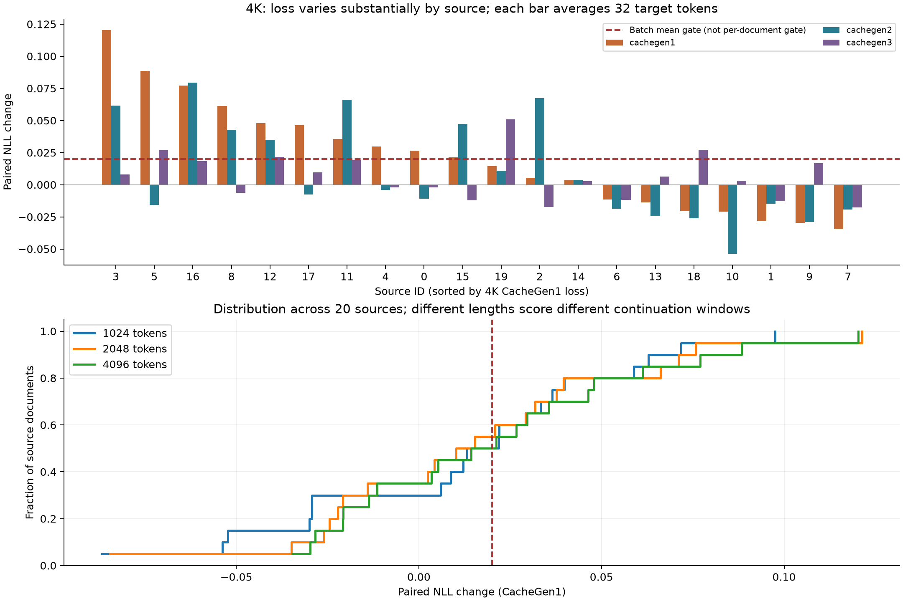
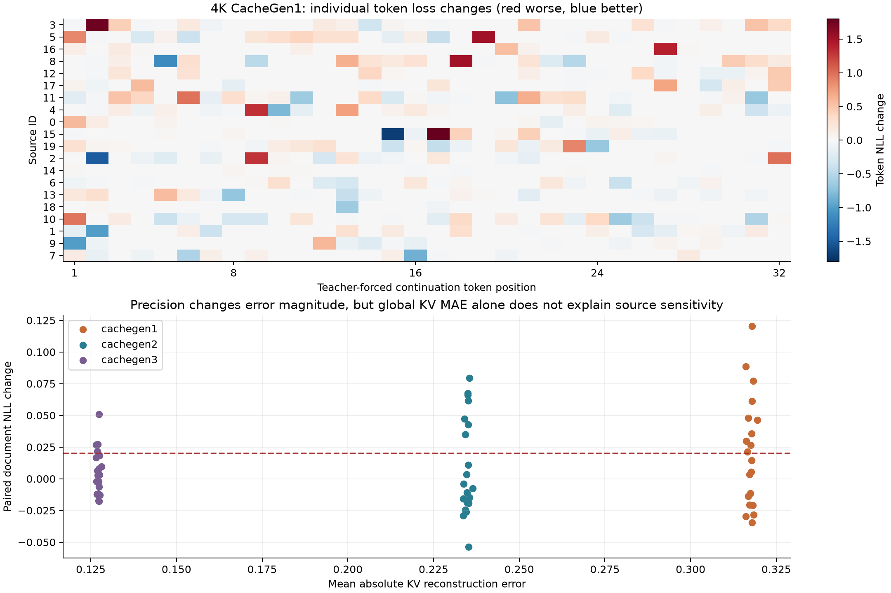

# 4K 压缩损失分布与原因分析

本分析只研究 `v3-larger-stable-20261025` 的自然续写 NLL，不混入 TriviaQA、TTFT、自适应或历史批次。读取已有记录，不启动模型、不修改量化参数、不剔除正式样本。重点是 4096-token 上 CacheGen1 的平均 ΔNLL=0.020898 略超 0.02 的预设门槛。

## 1. 是普遍退化还是少数文档拉高？

存在多数文档的损失增加，同时少数高损失文档使平均值对样本选择很敏感。不能概括为“所有文档都坏了”，也不能概括为“只有一个异常文档”。

| 4K 档位 | 平均 ΔNLL | 中位数 | 最小值 | 最大值 | 损失增加文档 | 单篇 ΔNLL>0.02 |
| --- | ---: | ---: | ---: | ---: | ---: | ---: |
| CacheGen1 | 0.020898 | 0.017734 | −0.034661 | 0.120279 | 13/20 | 10/20 |
| CacheGen2 | 0.009480 | −0.005743 | −0.053797 | 0.079309 | 9/20 | 7/20 |
| CacheGen3 | 0.006392 | 0.004700 | −0.017755 | 0.050997 | 12/20 | 4/20 |

这里“单篇>0.02”只是描述分布；正式门槛作用于整组平均值，不应把它改成事后新增的逐篇验收标准。负值只表示这些目标文本上的损失降低，不等于模型能力提升。

CacheGen1 损失最大的五个来源如下。同一行的三个档位使用相同上下文、相同 32 个正确目标 token，是有效的质量配对。

| 来源 ID | CacheGen1 ΔNLL | CacheGen2 ΔNLL | CacheGen3 ΔNLL |
| --- | ---: | ---: | ---: |
| 3 | 0.120279 | 0.061717 | 0.007903 |
| 5 | 0.088423 | −0.015766 | 0.026844 |
| 16 | 0.077060 | 0.079309 | 0.018494 |
| 8 | 0.061283 | 0.042725 | −0.006239 |
| 12 | 0.048021 | 0.034921 | 0.021512 |

敏感性检查：移除最差来源 ID 3 后，剩余均值为 0.015667；移除最差三个后为 0.007776。对每个来源分别做留一检查，均值范围是 [0.015667, 0.023822]，跨越门槛。这些检查仅说明平均值敏感，**不是删样本后的新正式结果**；原始 20 篇必须保留。

原有按来源抽样的描述性 95% 区间为 [0.002789, 0.039935]，也跨越 0.02。因此本次点估计未通过，但没有充分证据断言总体平均损失必然大于门槛。

## 2. 不是到了 4K 才出现这个现象

| CacheGen1 上下文长度 | 平均 ΔNLL | 中位数 | 损失增加文档 | 单篇>0.02 |
| --- | ---: | ---: | ---: | ---: |
| 1024 | 0.011615 | 0.017540 | 14/20 | 10/20 |
| 2048 | 0.014954 | 0.012777 | 13/20 | 9/20 |
| 4096 | 0.020898 | 0.017734 | 13/20 | 10/20 |

1K 与 4K 的中位数接近，单篇超过 0.02 的数量相同；并没有观察到文档层面突发的大面积失效。各长度都有正、负损失变化，平均值取决于两者的抵消。1K 的负向变化平均为 −0.04689，4K 为 −0.02280，抵消变少也影响了整体均值。

更重要的是，长度对照存在混杂：数据选择使用 `ids[:L]` 作上下文，`ids[L:L+32]` 作目标。因此 1K、2K、4K 虽是同一来源，预测的并不是同一段后续文本。例：ID 5 的 CacheGen1 在 1K/2K/4K 分别为 0.097574/−0.084525/0.088423，波动并不单调。现有数据不能单独证明“上下文长度增加导致 NLL 退化”，还可能是不同目标窗口的内容敏感性。

## 3. 逐 token 损失：短目标窗口对少数概率变化很敏感

每篇文档只评估 32 个后续 token。4K 的 20 篇共 640 个目标位置；它们在同一文档内相关，不能当作 640 个独立文档。CacheGen1 的 640 个位置中，314 个损失增加，其余没有增加；最大的 10 个正向损失变化，占所有正向变化之和的约 31.55%。这个比例不是净 ΔNLL 的贡献率，因为还有负向抵消。

最差来源 ID 3 的第 2 个目标 token：

- raw 的 token NLL：1.416872；CacheGen1：3.165930。
- 单 token ΔNLL：1.749058；贡献到该文档 32-token 均值为约 0.054658。
- 这约占该文档净 ΔNLL=0.120279 的 45.4%。
- 对正确 token 的概率比为 `exp(−1.749058)≈0.174`，即压缩后约为 raw 的 17.4%；这不是“准确率下降 82.6%”。

所以，短续写窗口中的个别敏感 token 就可以明显改变文档均值。NLL 使用 teacher forcing：每一步喂入的是正确前文，并非把前一步错误生成继续喂回去。因此这里不能解释成“第一个 token 答错后一路连锁生成错误”。

## 4. 代码与数据支持的首要原因：量化较粗，内容敏感性差异大

当前实际量化配置（bins 是量化配置参数，不是 bit 数）：

| 档位 | K：前10层 / 中10层 / 后12层 | V：前2层 / 后30层 | 4K 平均 KV MAE |
| --- | --- | --- | ---: |
| CacheGen1 | 16 / 16 / 12 | 16 / 12 | 0.31748 |
| CacheGen2 | 32 / 16 / 16 | 32 / 16 | 0.23479 |
| CacheGen3 | 32 / 32 / 32 | 32 / 32 | 0.12718 |

量化器对每层、每个 token，把所有 KV heads 的通道合并后取绝对最大值。它的缩放因子由 `C=bins//2−1` 决定，重建步长约为 `max_abs/C`。同一输入中 bins=12 的 C=5，而 bins=32 的 C=15，前者步长约为后者的三倍。CacheGen1 对后 30 层 V、后 12 层 K 都采用较粗设置，重建扰动更大；提高精度后平均 KV 误差和平均 ΔNLL 均下降。

这支持“粗量化是主要风险来源”的解释，但还不能精确归因为 V、某一层、某个 head 或某个 token 的异常值。档位间同时改变多个位置的精度，不是隔离单因素的因果消融。提高精度也不保证每篇单调改善：来源 ID 16 的 CacheGen2 ΔNLL 就略高于 CacheGen1。

文档内容对扰动的敏感性也有证据：同一 CacheGen1 档位的 4K 全局 KV MAE 只在约 0.31608–0.31953 之间变化，但 ΔNLL 从 −0.03466 到 0.12028；两者 Pearson 相关约 0.074（仅 20 篇的描述性统计）。因此仅凭平均 KV 重建误差无法解释哪些文档受损，关键误差落在哪些分量、以及模型如何使用这些分量可能更重要，尚需逐层/逐 head 数据确认。

## 5. 目前不能当作已确认根因的解释

| 解释 | 当前判断 |
| --- | --- |
| 4K 整段共用一个量化最大值，长度变长导致步长变大 | 与当前实现不符；尺度是每层/每 token 的通道最大值 |
| 模型生成错误逐 token 传染，造成 NLL 上升 | 本项评分使用 teacher forcing，不支持这个解释 |
| 256-token 应用分块或 CDF 重复造成这里的 NLL 损失 | 这里是整包质量实验；体积开销与量化质量是不同问题 |
| 概率表/算术编码本身必然造成有损恢复 | 算术编码设计上应无损恢复量化符号；现有小规模熵路径配对质量一致，但不能代替全部 4K 符号级核验 |
| 某个特定 V 层、head 或极值就是根因 | 没有逐层误差或隔离对照，尚不能定位 |
| 只删掉最差文档就算修复 | 不成立；这是更改评估样本，不是修复方法 |

## 6. 下一步最小验证顺序

无需立刻重跑全部 12594 条观测。已有证据最值得追踪的是来源 ID 3、5、16，另保留一个低损失来源作对照。若以后恢复 GPU，建议先：

1. 固定同一上下文和目标文本复现三档 NLL，核对“量化后未编码的重建 KV”与“编码再解码 KV”的符号/数值一致性，隔离量化损失与实现问题。
2. 只提高 K 或只提高 V 精度，记录逐层/逐 head 的误差与 NLL；再对有影响部分细分，定位是否确为低精度 V 或特定层主导。
3. 保留相同的 32 个目标 token，通过受控地改变前缀长度比较 1K/2K/4K，减少目标窗口变化的混杂；补充更长的固定续写窗口检查敏感性。

这些是待做实验，不是已经验证的修复。现在可以确认的是：**该档位产生较大的量化扰动；文档与目标 token 的敏感性高度不均；短评估窗口和少数高损失来源使均值是否越过门槛不稳定。尚不能把原因简单归结为 4K 长度本身。**

## 复算与材料

执行 `python3 reports/mistral/20261026-larger-analysis/loss_distribution/analyze_loss.py`。脚本先校验 records/selection/summary 的归档 SHA256，再核对每个方法与 raw 的目标 token 完全一致、逐 token NLL 与文档均值一致，以及分布均值与原汇总一致。

- [300 条逐文档配对](document_deltas.csv)：20 来源×3 长度×5 压缩方法。
- [9600 条逐 token 配对](token_deltas.csv)：上述每个条件的 32 个目标 token。
- [4K CacheGen1 排序](ranked_4k_cachegen1.csv)、[分布及敏感性数据](evidence.json)。
- [两页图表 PDF](loss-distribution.pdf)、[复算脚本](analyze_loss.py)。

代码依据：[归档模型与量化档位](../../../../results/mistral/larger/v3-larger-stable-20261025/source/experiments/engine.py)、[归档量化器](../../../../results/mistral/larger/v3-larger-stable-20261025/source/LMCache/lmcache/storage_backend/serde/cachegen_encoder.py)、[归档数据窗口选择](../../../../results/mistral/larger/v3-larger-stable-20261025/source/mini_repro/experiment_common.py)。返回[总体分析](../实验结果分析.md)。
