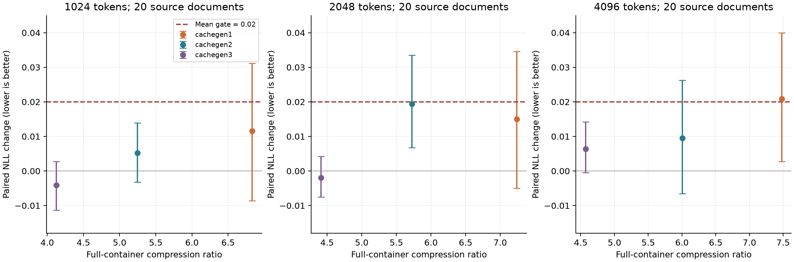
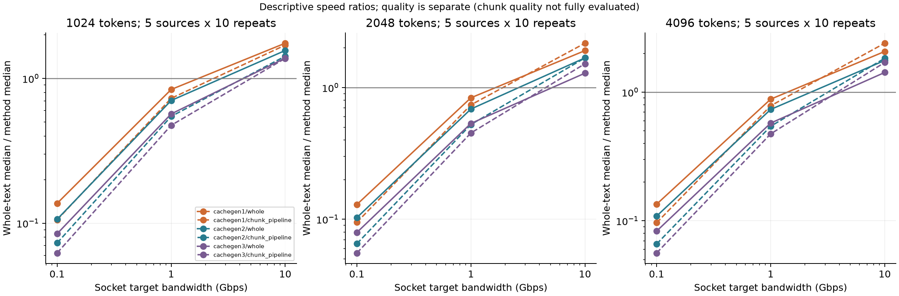
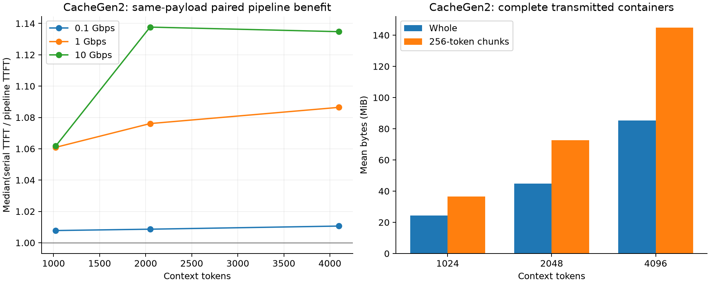
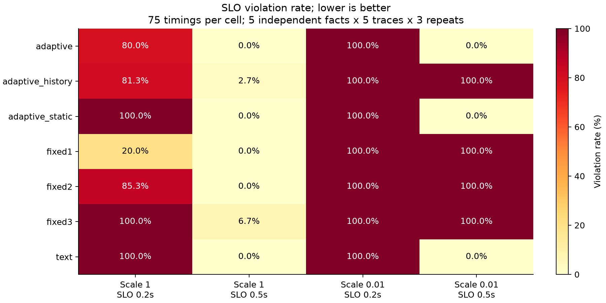

# Mistral 较大规模实验结果分析

本批次说明：KV 压缩显著减少了字节数；高速目标带宽下出现首 token 加速；相同分块的流水线有额外收益。但低带宽下文本重算更快，自适应策略也没有普遍优于固定档位。不能把这些结果概括为全部复现了论文的质量与加速结论。

分析仅使用 `v3-larger-stable-20261025`。运行配置为 RTX 4090 D、Mistral-7B FastChat 8bit 权重、FP16 KV，以及声明的稳定数值执行设置。正文数值由本目录 [analyze.py](analyze.py) 从本地原始数据生成；不需要 GPU，不改写原始归档。各输入/输出见文末。

## 1. 观测数量与统计单位

12594 条正式观测 = 360 条自然续写 + 540 条受控问答 + 120 条 TriviaQA + 9450 条 TTFT + 2100 条自适应 + 24 条消融。7/7 任务完成，退出码 0；175 项原始文件 SHA256 一致。程序重新核对全部 18 组质量均值、189 组 TTFT 中位数及 28 组自适应违规率。

这些不是 12594 个独立样本。自然续写为 20 个来源×3 长度；受控问答为 10 个事实×3 位置×3 长度；TriviaQA 为 20 题。TTFT 是 5 个来源×3 长度×3 带宽×7 方法×3 模式×10 次。自适应是 5 个事实×5 条轨迹×7 策略×2 倍率×2 SLO×3 次。既有区间按来源聚类抽样 2000 次，样本较少时用于描述，不构成质量等价证明。

## 2. 压缩：减少体积，但精度取舍不能省略

下面压缩比是完整序列化原始 FP16 KV 字节数÷完整压缩容器字节数；包括尺度、CDF 等元数据。ΔNLL 是同一来源相对 raw 的平均变化，越小越好。预设门槛是平均 ΔNLL≤0.02 且受控问答保留率≥90%。这是本框架门槛，并非论文统一验收标准。

| 长度 | 方法 | 压缩比 | 平均 ΔNLL | 描述性 95% 区间 | 点估计门槛 |
| --- | --- | --- | --- | --- | --- |
| 1024 | cachegen1 | 6.83× | 0.01161 | [-0.00856, 0.03112] | 通过 |
| 1024 | cachegen2 | 5.25× | 0.00525 | [-0.00324, 0.01395] | 通过 |
| 1024 | cachegen3 | 4.12× | -0.00407 | [-0.01133, 0.00274] | 通过 |
| 2048 | cachegen1 | 7.24× | 0.01495 | [-0.00496, 0.03462] | 通过 |
| 2048 | cachegen2 | 5.73× | 0.01942 | [0.00673, 0.03353] | 通过 |
| 2048 | cachegen3 | 4.41× | -0.00190 | [-0.00749, 0.00420] | 通过 |
| 4096 | cachegen1 | 7.48× | 0.02090 | [0.00279, 0.03993] | 未通过 |
| 4096 | cachegen2 | 6.01× | 0.00948 | [-0.00654, 0.02623] | 通过 |
| 4096 | cachegen3 | 4.57× | 0.00639 | [-0.00047, 0.01418] | 通过 |

CacheGen1 压缩最强，但 4096 token 的 ΔNLL=0.020898 超过门槛。该点的区间跨越 0.02，因此只能说本次点估计未通过，不能断言总体退化必然超过 0.02。CacheGen2 三种长度的点估计均通过，但 2048 token 的 ΔNLL=0.019415 已贴近门槛，且区间上限超过 0.02。CacheGen3 的三种长度区间上限均低于 0.02，在本批次自然续写上相对更稳健，体积也更大。负 ΔNLL 不应解释为压缩普遍提升模型能力。

uniform4 压缩约 3.98×、uniform8 约 2.00×，三种长度的现有点估计门槛均通过。不能只用 FP16 raw 对照证明 CacheGen 最优，还应在相近质量下比较 uniform4。

受控问答各方法都是 90/90 条件正确；它来自 10 个独立事实，说明该任务区分度有限。TriviaQA 的 raw 与 uniform8 是 16/20 正确，其余方法是 15/20。所有低分方法都少对 1 题，但丢失的题并不相同：

| 题目 ID | 方法 | raw 输出 | 该方法输出 |
| --- | --- | --- | --- |
| tqa-29 | uniform4 | Julian Fellowes | Downton Abbey |
| tqa-29 | cachegen1 | Julian Fellowes | Downton Abbey |
| tqa-32 | cachegen2 | Train | A locomotive |
| tqa-32 | cachegen3 | Train | A locomotive |

EM 按预先声明的答案别名评分，不能分析后手工扩大同义词来改变本次结果。CacheGen 的配对 EM 差均为 −5 个百分点，现有描述性区间为 [−15, 0] 个百分点：观察到少对一题，但小样本既不能证明总体无损，也不足以精确估计损失。

## 3. 传输：必须先选对文本基线

TTFT 包含 socket 建立、实际限速传输、接收端恢复/分词及首 token 在 CPU 可用之前的推理；不包括离线 prefill、编码和后续生成。所有结论都以已预先准备缓存为前提，不能直接用于只有一次访问且必须先建缓存的请求。

以整包 CacheGen2 对整包文本为例，以下为 50 次计时的 TTFT 中位数：

| 长度 | 目标 Gbps | 整包文本 ms | 整包 CacheGen2 ms | 文本/CacheGen2 |
| --- | --- | --- | --- | --- |
| 1024 | 0.1 | 232.0 | 2179.3 | 0.11× |
| 1024 | 1 | 229.6 | 325.9 | 0.70× |
| 1024 | 10 | 224.4 | 143.8 | 1.56× |
| 2048 | 0.1 | 408.1 | 3964.9 | 0.10× |
| 2048 | 1 | 404.4 | 588.4 | 0.69× |
| 2048 | 10 | 400.6 | 238.5 | 1.68× |
| 4096 | 0.1 | 822.0 | 7553.9 | 0.11× |
| 4096 | 1 | 818.0 | 1114.7 | 0.73× |
| 4096 | 10 | 817.2 | 463.5 | 1.76× |

低带宽时，压缩 KV 仍是数十 MiB，而文本只有数 KiB；即使省下 prefill，传输开销也可能更大。4096 token、0.1 Gbps 时，CacheGen2 平均传输约 7.223 秒；文本整段 TTFT 中位数约 0.822 秒。10 Gbps 目标下，CacheGen2 平均传输约 0.145 秒、恢复约 0.166 秒，才有机会优于约 0.817 秒的文本重算。这些相位是均值、TTFT 表是中位数，不能直接相加核对；流水线相位还存在重叠。

以 4096 token、10 Gbps 为例：整包文本 817.2ms、分块文本流水线 1397.3ms、CacheGen2 流水线 445.5ms。现有 `ttft.csv` 的 `speedup_vs_text=3.14×` 对应分块文本；改用较快的整包文本后约为 **1.83×**。两种数字各自有含义，但不能混用。新导出的 [baseline_comparison.csv](baseline_comparison.csv) 同时列出这两种口径。

同条件的 uniform4 流水线约 390.2ms，比 CacheGen2 流水线更快；但整包 uniform4 约 658.5ms，又慢于整包 CacheGen2 约 463.5ms。档位、分块和基线一起影响结论，不能从单个有利对照宣称方法普遍更优。

`same_length_quality_acceptance` 取自整包质量实验，只是同长度参考，并未重新评估 256-token 独立量化表示的完整 NLL/QA。分块重新计算尺度与 CDF，质量可能变化；全部 TTFT 首 token 与 raw 相同不等于完整回答质量相同。故分块速度可以测量和配对，但完整的质量—速度结论仍缺分块对应质量证据。

目标带宽由本地 socket 限速器设定，不等于真实物理链路容量；尤其 10 Gbps 下实际吞吐受消息、Python 与调度影响。现有数据只有 0.1/1/10 三个点，不能精确推出拐点带宽，也不能直接外推多机 WAN。

## 4. 流水线：有重叠，收益被分块体积抵消一部分

只有相同消息的 chunk_serial 与 chunk_pipeline 配对，才能单独衡量流水线收益。CacheGen2 的中位配对加速比如下（串行 TTFT÷流水线 TTFT）：

| 长度 | 目标 Gbps | 配对加速比 | 平均重叠 ms |
| --- | --- | --- | --- |
| 1024 | 0.1 | 1.008× | 27.5 |
| 1024 | 1 | 1.061× | 27.2 |
| 1024 | 10 | 1.062× | 25.2 |
| 2048 | 0.1 | 1.009× | 60.2 |
| 2048 | 1 | 1.076× | 63.6 |
| 2048 | 10 | 1.138× | 54.9 |
| 4096 | 0.1 | 1.011× | 146.2 |
| 4096 | 1 | 1.086× | 151.2 |
| 4096 | 10 | 1.135× | 125.9 |

例如 4096 token、10 Gbps，CacheGen2 分块串行约 516.5ms、流水线约 445.5ms；配对中位加速约 1.135×。这证明受控实现中重叠确有收益，不代表相对整包方案同样能快 13.5%。

同样的 4096-token 输入，CacheGen2 整包平均传输 85.24MiB，256-token 分块合计 144.85MiB，多约 70%。分块各自携带尺度、CDF 和流长度元数据，也改变局部分布与量化；当前按包计算/发送 CDF，不能复用论文中的模型级共用分布。CDF 重复是可从实现确认的开销来源，但现有汇总没有对全部字节损失逐项归因，不把增量全部归给某一个字段。

由此可解释：分块串行较慢，流水线又追回部分时间；最终是否超过整包方案，取决于字节膨胀和重叠收益的平衡。详见 [wire_sizes.csv](wire_sizes.csv)。

## 5. 自适应：紧 SLO 下固定低档更好；历史策略有首块失配

以下每格是 SLO 违规率，每个策略/条件 75 次计时，来自 5 事实×5 轨迹×3 次重复。全部策略的本组受控 EM 都是 1。

| 策略 | 倍率1 / 0.2s | 倍率1 / 0.5s | 倍率0.01 / 0.2s | 倍率0.01 / 0.5s |
| --- | --- | --- | --- | --- |
| adaptive | 80.00% | 0.00% | 100.00% | 0.00% |
| adaptive_history | 81.33% | 2.67% | 100.00% | 100.00% |
| adaptive_static | 100.00% | 0.00% | 100.00% | 0.00% |
| fixed1 | 20.00% | 0.00% | 100.00% | 100.00% |
| fixed2 | 85.33% | 0.00% | 100.00% | 100.00% |
| fixed3 | 100.00% | 6.67% | 100.00% | 100.00% |
| text | 100.00% | 0.00% | 100.00% | 0.00% |

`adaptive` 读取当前块的轨迹带宽；`adaptive_history` 只用上一个完整消息的实测吞吐，首块固定猜测 1 Gbps。前者信息条件更有利，不能将其收益直接视为历史在线估计策略的收益。

倍率1、0.2秒时，fixed1 违规率只有 20%，而 adaptive 为 80%、history 约 81.3%。当前自适应优先尝试精度最高的可行档位，固定低档则牺牲精度预算换速度；本次受控 EM 没有区分这些精度差别。结果说明本次策略没有在紧 SLO 下取得最好的实测达标率，不代表固定低档在所有自然任务都满足相同质量要求。也不能只和 100% 违规的文本对照来夸大自适应优势。

低带宽倍率0.01时，当前带宽策略的 75 次请求均选择四块文本；历史策略则出现一致的首块问题：

| SLO | 首块选择 | 首块传输中位数 | 仅首块已超时 | 后三块回退文本 |
| --- | --- | --- | --- | --- |
| 0.2s | {1: 75} | 1.026s | 75/75 | 225/225 |
| 0.5s | {3: 75} | 1.794s | 75/75 | 225/225 |

这是逐块日志直接支持的解释：初始 1 Gbps 估计下选择 KV，真实首块传输已消耗 1.03/1.79 秒，随后即使三块全退回文本也无法追回 0.2/0.5 秒的期限。宽松 SLO 在这个实现和低带宽设置中反而允许选择更大的首块，最终更慢。它不是压缩器不能恢复 KV，而是初始带宽假设、选档和不可撤销首块传输的组合问题。现有数据没有运行新的初值/探测/超时中止对照，不能声称某个修复已经验证有效。

倍率0.01、0.2秒时，文本也 100% 超时（中位数约 0.384秒）；因此该条件下这些已测策略都没满足目标。0.5秒时文本本来已全部达标，自适应回退文本没有额外的达标率收益。

## 6. 消融：熵编码的体积贡献有直接证据，分层优势仍未被单独识别

12 组打包/算术编码配对共用完全相同的量化符号和尺度，恢复与质量结果一致。完整容器的额外压缩为 1.29–1.73×，说明熵编码在这些小样本上确实节省字节。仅比较符号流会高估收益，因为 CDF 等元数据也需要发送。

但本组只有 1 个自然来源、1 个事实的 3 个位置。uniform16/32 实际为 4/5-bit 符号预算，layered2 平均约 4.1875 bit；不能把不同位预算的 NLL 差异全部归因于分层分配。统一位打包路径主要在 CPU/NumPy 执行，算术编码路径使用 CUDA，计时差同时含实现和设备因素，不是纯算法加速比较。

## 7. 这批结果支持什么，后续先做什么

| 结论 | 本批次证据 |
| --- | --- |
| 完整 KV 容器可明显缩小 | 支持；三档约 4.13–7.48×，需附档位与质量条件 |
| 高速目标带宽下缓存复用可减少 TTFT | 支持部分条件；例如整包 CacheGen2 在 10 Gbps 下约 1.56–1.76× |
| 同字节流水线有额外收益 | 支持；与相同分块串行配对比较 |
| 压缩始终优于文本重算 | 不支持；低带宽明显更慢 |
| 自适应优于所有固定策略且总能满足 SLO | 不支持；紧 SLO 的 fixed1 更好，低带宽 history 首块就超时 |
| 质量完全不变，且所有档位通过门槛 | 不支持；4096/CacheGen1 未过点估计门槛，TriviaQA 丢失题目 |
| 256-token 分块质量等同整包质量 | 证据不足；已有首 token/同字节正确性不能替代完整分块 NLL/QA |
| 已复现论文全部倍数及完整方法 | 不支持；模型/硬件/文本基线不同，anchor/delta、模型级共用 CDF 和完整论文调度器未实现 |

建议先完成现有数据的论文式展示：分别呈现整包端到端收益、同分块流水线收益和 SLO—质量取舍；不合并不同基线，不调整既定门槛。若以后需要新增 GPU 实验，优先补分块 NLL/真实 QA、历史策略冷启动对照，以及匹配总位预算的分层消融，再决定是否扩展规模。服务器关闭不影响当前全部离线核验、统计与绘图。

## 文件与离线复算

原始批次：[report.md](../../../results/mistral/larger/v3-larger-stable-20261025/report.md)、[quality.csv](../../../results/mistral/larger/v3-larger-stable-20261025/quality.csv)、[ttft.csv](../../../results/mistral/larger/v3-larger-stable-20261025/ttft.csv)、[adaptive.csv](../../../results/mistral/larger/v3-larger-stable-20261025/adaptive.csv)。原始大文件通过该批次 README 的分卷命令恢复。边界见 [论文对照](../../../docs/reproduction/PAPER_ALIGNMENT.md)。

新增输出：[核验与首块证据](evidence.json)、[字节数](wire_sizes.csv)、[双基线对照](baseline_comparison.csv)、[TriviaQA 差异](triviaqa_changes.csv)。所有图表是描述性图，不把样本量或计时重复放大为独立证据。

```bash
python3 reports/mistral/20261026-larger-analysis/analyze.py
```

复算需 Python 标准库与 matplotlib；读取现成报告无需安装环境。脚本会先核验 175 项原始文件，缺少大文件时应先恢复归档。图表标注使用英文便于跨平台字体显示，PNG 与四页 PDF 均可独立分享。









[四页图表 PDF](analysis-figures.pdf)
