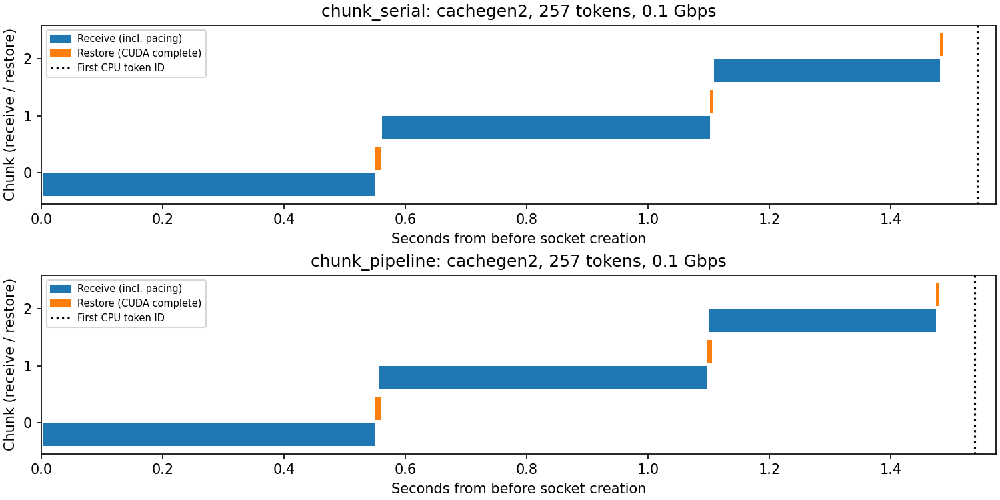
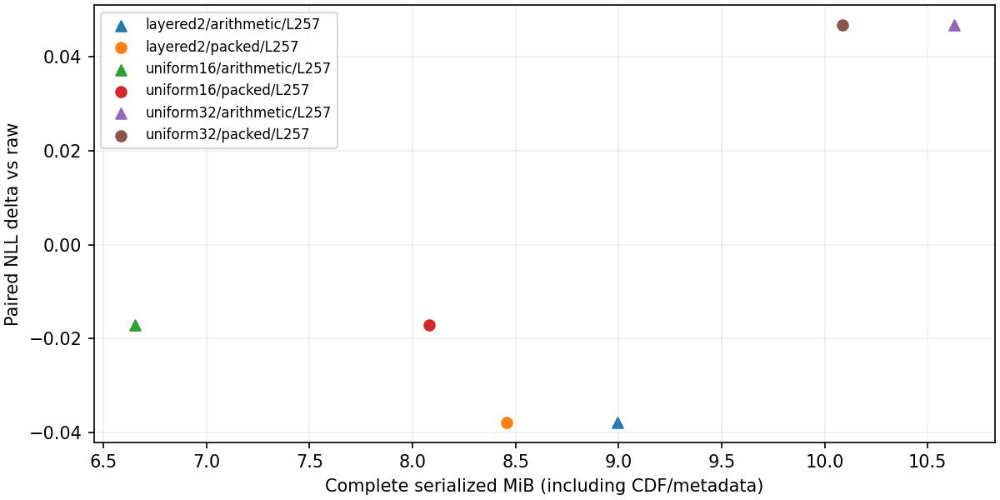

# 共享框架 v3 功能验收（2026-10-25）

代码已接入分块串行／流水线、历史吞吐策略及轻量机制消融。TinyLlama 与 Mistral 使用逐文件相同的公共源码，在 RTX 4090 D 上各完成 **7/7 任务、274/274 正式观测**，退出码均为 0。以下为功能覆盖与一致性验证，质量与速度以逐项实测为准。

两个最终批次均由 tmux 运行；Mistral 在 TTFT 阶段执行 TERM（143），同一代码与配置恢复后完成。此前提交的 81 行 SHA 全部保持不变，2 组串行／流水线配对跨越了两次尝试，仍复用同样消息字节并生成相同首 token。详见 [机器验证记录](validation.json)。

86 项公共回归与 3 项 Mistral 兼容检查通过；包括实际 CUDA 符号恢复、零值/小幅值、257-token 尾段、发送前预算后的接收可用时刻、队列阻塞、异常线程清理、历史信息隔离、位打包和稳定观测 ID。完整日志在两批原始目录的 validation/。

## 范围与口径

每模型质量54条；TTFT168条（4个文档/长度条件×2带宽×7方法×3模式）；四组倍率/SLO自适应共28条（7策略）；消融24条（1自然条件＋1事实的3位置，3精度×2熵路径）。另有196次网络任务预热。消融每行保存3次编解码计时及1次预热。自然文档、事实、问题、条件及重复分别计数；这是最小功能矩阵，不能据此推出大规模收益或统计显著性。

应用块128 token，长度128/257覆盖单块及128＋128＋1尾块；原始CUDA内部最多256 token另记。原整包文本参考保留一次上下文＋问题forward；两个分块模式使用同一逐块前缀prefill和同一编码字节。发送、接收为CPU线程，GPU恢复/拼接/模型均在主线程；容量1的发送许可限制预取。

历史吞吐首块固定1 Gbps，后续仅使用上一完整消息字节／有效接收区间。接收容量/上一块GPU等待不计入该区间，正常限速与socket开销计入。完整决策序列和各档预测成本在records.jsonl；当前策略仍为本地启发式。

消融先共用一次原量化符号/尺度，实际4/5-bit打包与原GPU算术编码共用反量化。纯符号、CDF和完整容器分别计字节。统一16/32的名称指bins，实际4/5bit；分层2的位宽预算独立明示。量化阶段包含符号范围/尺度有效性验证，熵编码计时另存；这些少量设置展示体积—质量取舍。

## 实测流水线配对（仅多块257-token条件）

每行来自两个文档的配对速度比中位数，串行TTFT÷流水线TTFT；小于1表示流水线较慢。所有方法和两个带宽都逐项保留，不预设加速。

### tinyllama

| method | target_bandwidth_gbps | paired_observations | median_paired_speedup | mean_pipeline_overlap_seconds |
| --- | --- | --- | --- | --- |
| cachegen1 | 0.1 | 2 | 1.0254 | 0.0039709 |
| cachegen2 | 0.1 | 2 | 0.99715 | 0.0037153 |
| cachegen3 | 0.1 | 2 | 0.99211 | 0.003993 |
| raw | 0.1 | 2 | 0.99718 | 0.0012162 |
| text | 0.1 | 2 | 0.82398 | 0.00053387 |
| uniform4 | 0.1 | 2 | 0.99602 | 0.0017942 |
| uniform8 | 0.1 | 2 | 0.97026 | 0.0016321 |
| cachegen1 | 10 | 2 | 1.0731 | 0.002773 |
| cachegen2 | 10 | 2 | 1.1197 | 0.004903 |
| cachegen3 | 10 | 2 | 0.71759 | 0.0055657 |
| raw | 10 | 2 | 1.4784 | 0.00021946 |
| text | 10 | 2 | 1.1014 | 0.00028983 |
| uniform4 | 10 | 2 | 1.4693 | 0.00083668 |
| uniform8 | 10 | 2 | 0.87296 | 0.0012657 |

### mistral

| method | target_bandwidth_gbps | paired_observations | median_paired_speedup | mean_pipeline_overlap_seconds |
| --- | --- | --- | --- | --- |
| cachegen1 | 0.1 | 2 | 1.0091 | 0.0080194 |
| cachegen2 | 0.1 | 2 | 1.0055 | 0.0085832 |
| cachegen3 | 0.1 | 2 | 1.008 | 0.008704 |
| raw | 0.1 | 2 | 1.0013 | 0.0059572 |
| text | 0.1 | 2 | 0.99139 | 0.00085652 |
| uniform4 | 0.1 | 2 | 1.0048 | 0.0020321 |
| uniform8 | 0.1 | 2 | 0.99839 | 0.010075 |
| cachegen1 | 10 | 2 | 1.0722 | 0.0075383 |
| cachegen2 | 10 | 2 | 1.0599 | 0.0090331 |
| cachegen3 | 10 | 2 | 1.0122 | 0.011681 |
| raw | 10 | 2 | 0.95446 | 0.0058001 |
| text | 10 | 2 | 1.0157 | 0.0003682 |
| uniform4 | 10 | 2 | 0.94138 | 0.0059418 |
| uniform8 | 10 | 2 | 1.1476 | 0.0014668 |

## 历史吞吐与当前带宽策略

下表保留四组配置；单事实、单轨迹、单计时重复仅用于检查策略执行与记录。静态、三固定档及纯文本保留在完整CSV和原始报告。

### tinyllama

| task | strategy | median_ttft_seconds | slo_violation_rate | condition_mean_em |
| --- | --- | --- | --- | --- |
| adaptive-scale-0.01-slo-0.2 | adaptive | 0.080091 | 0 | 0 |
| adaptive-scale-0.01-slo-0.2 | adaptive_history | 1.9647 | 1 | 0 |
| adaptive-scale-0.01-slo-0.5 | adaptive | 0.44674 | 0 | 0 |
| adaptive-scale-0.01-slo-0.5 | adaptive_history | 1.9519 | 1 | 0 |
| adaptive-scale-1-slo-0.2 | adaptive | 0.055815 | 0 | 0 |
| adaptive-scale-1-slo-0.2 | adaptive_history | 0.052359 | 0 | 0 |
| adaptive-scale-1-slo-0.5 | adaptive | 0.057785 | 0 | 0 |
| adaptive-scale-1-slo-0.5 | adaptive_history | 0.074473 | 0 | 0 |

### mistral

| task | strategy | median_ttft_seconds | slo_violation_rate | condition_mean_em |
| --- | --- | --- | --- | --- |
| adaptive-scale-0.01-slo-0.2 | adaptive | 0.22115 | 1 | 1 |
| adaptive-scale-0.01-slo-0.2 | adaptive_history | 6.0319 | 1 | 1 |
| adaptive-scale-0.01-slo-0.5 | adaptive | 0.2332 | 0 | 1 |
| adaptive-scale-0.01-slo-0.5 | adaptive_history | 10.804 | 1 | 1 |
| adaptive-scale-1-slo-0.2 | adaptive | 0.17298 | 0 | 1 |
| adaptive-scale-1-slo-0.2 | adaptive_history | 0.23692 | 1 | 1 |
| adaptive-scale-1-slo-0.5 | adaptive | 0.22311 | 0 | 1 |
| adaptive-scale-1-slo-0.5 | adaptive_history | 0.23432 | 0 | 1 |

## 机制消融

packed/arithmetic两路径的符号、尺度、恢复KV、NLL和生成结果逐项相同。完整字节可能因CDF和容器开销高于直接打包；不能把纯符号收益当作完整空间收益。不同精度预算的质量变化不单独归因于分层。负ΔNLL本身不证明质量提升。

### tinyllama

| precision | entropy | mean_symbol_bits | mean_symbol_data_bytes | mean_complete_bytes | paired_nll_delta | mean_em | mean_encode_excluding_quantize_seconds | mean_decode_seconds |
| --- | --- | --- | --- | --- | --- | --- | --- | --- |
| layered2 | arithmetic | 4.2045 | 872028 | 1730888 | -0.061345 | 0.33333 | 0.0034063 | 0.0028107 |
| layered2 | packed | 4.2045 | 1521440 | 1555919 | -0.061345 | 0.33333 | 0.098431 | 0.18951 |
| uniform16 | arithmetic | 4 | 801515 | 1299848 | -0.061364 | 0.33333 | 0.0028102 | 0.0025851 |
| uniform16 | packed | 4 | 1447424 | 1481999 | -0.061364 | 0.33333 | 0.097748 | 0.18326 |
| uniform32 | arithmetic | 5 | 1162696 | 2021512 | 0.026119 | 0.66667 | 0.0042532 | 0.0031641 |
| uniform32 | packed | 5 | 1809280 | 1842959 | 0.026119 | 0.66667 | 0.10036 | 0.20506 |

### mistral

| precision | entropy | mean_symbol_bits | mean_symbol_data_bytes | mean_complete_bytes | paired_nll_delta | mean_em | mean_encode_excluding_quantize_seconds | mean_decode_seconds |
| --- | --- | --- | --- | --- | --- | --- | --- | --- |
| layered2 | arithmetic | 4.1875 | 4548152 | 9433288 | -0.037849 | 1 | 0.010563 | 0.0070383 |
| layered2 | packed | 4.1875 | 8816128 | 8866515 | -0.037849 | 1 | 0.40412 | 0.77873 |
| uniform16 | arithmetic | 4 | 4189014 | 6977032 | -0.017038 | 1 | 0.0098589 | 0.0055632 |
| uniform16 | packed | 4 | 8421376 | 8471763 | -0.017038 | 1 | 0.55582 | 1.0493 |
| uniform32 | arithmetic | 5 | 6257516 | 11142664 | 0.046722 | 1 | 0.020293 | 0.0083544 |
| uniform32 | packed | 5 | 10526720 | 10577107 | 0.046722 | 1 | 0.55797 | 1.1967 |

## 原始结果与操作

- [tinyllama完整报告](../../results/tinyllama/minimal/v3-final-03/report.md) · [配置](../../results/tinyllama/minimal/v3-final-03/config.json) · [原始记录](../../results/tinyllama/minimal/v3-final-03/records.jsonl) · [时间线CSV](../../results/tinyllama/minimal/v3-final-03/ttft_timeline.csv)
- [mistral完整报告](../../results/mistral/minimal/v3-final-03/report.md) · [配置](../../results/mistral/minimal/v3-final-03/config.json) · [原始记录](../../results/mistral/minimal/v3-final-03/records.jsonl) · [时间线CSV](../../results/mistral/minimal/v3-final-03/ttft_timeline.csv)

[运行、配置与tmux恢复指南](../../docs/reproduction/SHARED_FRAMEWORK.md) · [要求/代码/测试对应表](../../docs/reproduction/V3_CHANGE_AUDIT.md) · [归档来源及SHA](source-reference.json)。v1/v2及本次开发诊断不混入以上最终汇总；较大配置只有预检，没有启动测量。
