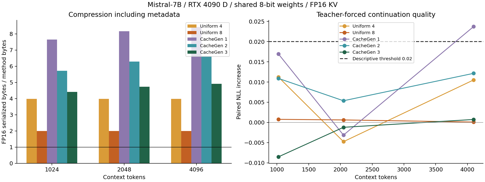
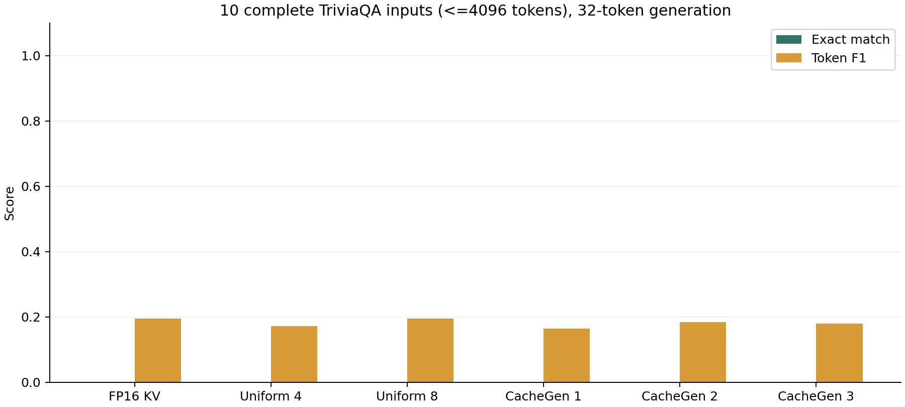
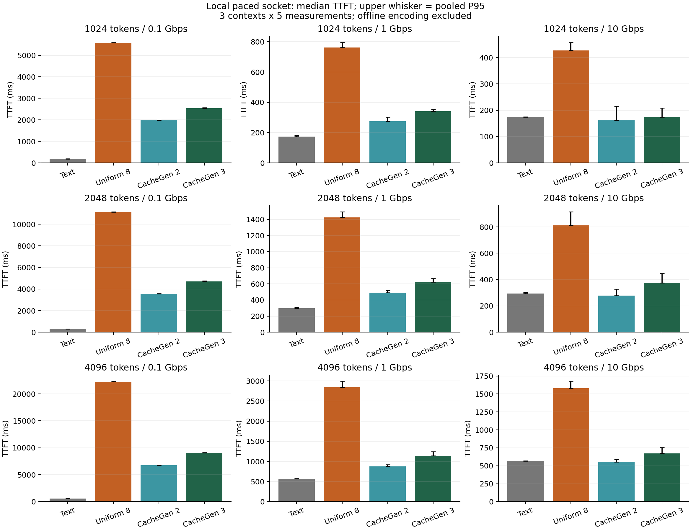

# Mistral-7B CacheGen 小规模复现

模型：mistral-community/Mistral-7B-v0.2；revision：80cf49b18de6354fd8a6d1e81c177dd830e05eea。当前批次使用 RTX 4090 D，FastChat 8bit 权重，FP16 KV。

## 实验口径

30 个自然文本上下文（10 条源文本×3 长度）、10 条完整短 TriviaQA、540 次正式 TTFT 计时。种子为 0。

自然文本 NLL 对 32-token 后续文本中的第 2–32 个 token 评分。TriviaQA 按完整 32-token 生成结果计算标准化 EM/F1，取答案别名最大分。

体积包含实际序列化元数据。uniform4 使用位打包。TTFT 通过本机限速 socket 传送实际字节，收完后恢复并生成首 token；离线编码不计入 TTFT。

作者仓库编码路径没有论文 anchor/delta 阶段；本实验没有跨服务器传输和传输—解码流水线，不构成完整论文系统复现。

## 配对体积与续写质量

| context_tokens | method | contexts | raw_serialized_over_method | paired_nll_delta | mean_kv_mae | passes_descriptive_threshold |
| --- | --- | --- | --- | --- | --- | --- |
| 1024 | raw | 10 | 1 | 0 | 0 | False |
| 1024 | uniform4 | 10 | 3.9843 | 0.011232 | 0.26001 | False |
| 1024 | uniform8 | 10 | 1.9961 | 0.00076829 | 0.014463 | False |
| 1024 | cachegen1 | 10 | 7.647 | 0.016943 | 0.30608 | False |
| 1024 | cachegen2 | 10 | 5.7139 | 0.010894 | 0.22587 | False |
| 1024 | cachegen3 | 10 | 4.4078 | -0.008511 | 0.1223 | False |
| 2048 | raw | 10 | 1 | 0 | 0 | False |
| 2048 | uniform4 | 10 | 3.9844 | -0.0047557 | 0.26562 | False |
| 2048 | uniform8 | 10 | 1.9961 | 0.00062364 | 0.014788 | False |
| 2048 | cachegen1 | 10 | 8.1583 | -0.0031296 | 0.31247 | False |
| 2048 | cachegen2 | 10 | 6.2841 | 0.0053665 | 0.23093 | False |
| 2048 | cachegen3 | 10 | 4.7353 | -0.0012036 | 0.12506 | False |
| 4096 | raw | 10 | 1 | 0 | 0 | False |
| 4096 | uniform4 | 10 | 3.9844 | 0.010508 | 0.26986 | False |
| 4096 | uniform8 | 10 | 1.9961 | 9.5245e-05 | 0.015032 | False |
| 4096 | cachegen1 | 10 | 8.4273 | 0.023709 | 0.31734 | False |
| 4096 | cachegen2 | 10 | 6.6046 | 0.012145 | 0.23467 | False |
| 4096 | cachegen3 | 10 | 4.9122 | 0.00073229 | 0.12713 | False |

描述性门槛：平均配对 NLL 增量≤0.02，且保留≥90% 原始 KV 的 EM 正确题。QA 来自独立的混合长度样本，不能解释为每个长度的 QA 等价性证明；小样本门槛也不构成统计非劣证明。

## 完整 TriviaQA

| method | questions | mean_em | mean_f1 | raw_em_correct | raw_correct_retention |
| --- | --- | --- | --- | --- | --- |
| raw | 10 | 0 | 0.19576 | 0 | None |
| uniform4 | 10 | 0 | 0.17219 | 0 | None |
| uniform8 | 10 | 0 | 0.19576 | 0 | None |
| cachegen1 | 10 | 0 | 0.16437 | 0 | None |
| cachegen2 | 10 | 0 | 0.18514 | 0 | None |
| cachegen3 | 10 | 0 | 0.18038 | 0 | None |

逐题输入选择见 qa_selection.json，原始答案与预测见 quality.json。

## 传输与首 token 延迟

| context_tokens | bandwidth_gbps | method | observations | median_seconds | p95_seconds | speedup_vs_text | speedup_vs_uniform8 |
| --- | --- | --- | --- | --- | --- | --- | --- |
| 1024 | 0.1 | cachegen2 | 15 | 1.9775 | 1.9945 | 0.092285 | 2.8215 |
| 1024 | 0.1 | cachegen3 | 15 | 2.5399 | 2.5733 | 0.071849 | 2.1967 |
| 1024 | 0.1 | text | 15 | 0.18249 | 0.18955 | 1 | 30.574 |
| 1024 | 0.1 | uniform8 | 15 | 5.5794 | 5.6039 | 0.032708 | 1 |
| 1024 | 1 | cachegen2 | 15 | 0.27536 | 0.30272 | 0.63347 | 2.7681 |
| 1024 | 1 | cachegen3 | 15 | 0.3405 | 0.35318 | 0.51228 | 2.2385 |
| 1024 | 1 | text | 15 | 0.17443 | 0.1818 | 1 | 4.3697 |
| 1024 | 1 | uniform8 | 15 | 0.7622 | 0.79582 | 0.22885 | 1 |
| 1024 | 10 | cachegen2 | 15 | 0.16153 | 0.21502 | 1.0773 | 2.6467 |
| 1024 | 10 | cachegen3 | 15 | 0.17419 | 0.20902 | 0.99902 | 2.4544 |
| 1024 | 10 | text | 15 | 0.17402 | 0.17467 | 1 | 2.4568 |
| 1024 | 10 | uniform8 | 15 | 0.42753 | 0.45785 | 0.40703 | 1 |
| 2048 | 0.1 | cachegen2 | 15 | 3.5727 | 3.5802 | 0.084269 | 3.1172 |
| 2048 | 0.1 | cachegen3 | 15 | 4.7123 | 4.7543 | 0.063889 | 2.3633 |
| 2048 | 0.1 | text | 15 | 0.30106 | 0.30674 | 1 | 36.991 |
| 2048 | 0.1 | uniform8 | 15 | 11.137 | 11.164 | 0.027034 | 1 |
| 2048 | 1 | cachegen2 | 15 | 0.49128 | 0.522 | 0.60552 | 2.8965 |
| 2048 | 1 | cachegen3 | 15 | 0.62333 | 0.66572 | 0.47725 | 2.2829 |
| 2048 | 1 | text | 15 | 0.29748 | 0.3068 | 1 | 4.7834 |
| 2048 | 1 | uniform8 | 15 | 1.423 | 1.4945 | 0.20905 | 1 |
| 2048 | 10 | cachegen2 | 15 | 0.27789 | 0.32671 | 1.0573 | 2.919 |
| 2048 | 10 | cachegen3 | 15 | 0.37528 | 0.4469 | 0.78292 | 2.1615 |
| 2048 | 10 | text | 15 | 0.29381 | 0.30386 | 1 | 2.7608 |
| 2048 | 10 | uniform8 | 15 | 0.81117 | 0.91523 | 0.36221 | 1 |
| 4096 | 0.1 | cachegen2 | 15 | 6.757 | 6.7742 | 0.084872 | 3.2946 |
| 4096 | 0.1 | cachegen3 | 15 | 9.0687 | 9.1208 | 0.063237 | 2.4547 |
| 4096 | 0.1 | text | 15 | 0.57348 | 0.58103 | 1 | 38.818 |
| 4096 | 0.1 | uniform8 | 15 | 22.261 | 22.369 | 0.025761 | 1 |
| 4096 | 1 | cachegen2 | 15 | 0.87437 | 0.92141 | 0.6512 | 3.2499 |
| 4096 | 1 | cachegen3 | 15 | 1.1393 | 1.2455 | 0.49978 | 2.4943 |
| 4096 | 1 | text | 15 | 0.56939 | 0.57795 | 1 | 4.9907 |
| 4096 | 1 | uniform8 | 15 | 2.8416 | 2.9962 | 0.20037 | 1 |
| 4096 | 10 | cachegen2 | 15 | 0.55379 | 0.58824 | 1.0178 | 2.8557 |
| 4096 | 10 | cachegen3 | 15 | 0.67059 | 0.75242 | 0.84051 | 2.3583 |
| 4096 | 10 | text | 15 | 0.56363 | 0.56886 | 1 | 2.8059 |
| 4096 | 10 | uniform8 | 15 | 1.5815 | 1.6791 | 0.3564 | 1 |

速度比>1 表示更快。中位数和 P95 汇总同条件的 3 个上下文×5 次重复；重复不增加独立上下文数量。缓存方法与文本的首 token 一致率是诊断指标。

逐项传输、恢复、首 token 开销和有效带宽见 ttft.csv。高带宽设定不等同于实际吞吐。

## 可追溯信息

metadata.json 保存模型校验、源码/数据指纹、CUDA 扩展和环境；manifest.json 保存进度与运行状态。run.log 保存完整日志。

## 本批次结果解释

本批次原始 KV 的完整输出 EM 正确题数为 0，因此“原始正确题保留率”不可计算，预设的联合质量门槛未获支持。quality.csv 中的 False 表示没有足够证据通过该门槛，不表示所有压缩方法都比原始 KV 差。本轮按事先固定的完整生成输出计算 EM/F1；模型输出附加内容也会降低严格 EM，故需结合逐题预测和配对 NLL 阅读。

CacheGen 3 的“原始序列化 KV / 压缩 KV”体积比分别为 1024 token：4.408×、2048 token：4.735×、4096 token：4.912×。

对应配对 NLL 增量分别为 -0.00851、-0.00120、+0.00073。

10 条完整 TriviaQA 上，原始 KV 的 EM/F1 为 0.000/0.196；CacheGen 3 为 0.000/0.180。

9 个长度/带宽组合中，CacheGen 3 有 0/9 个组合的中位 TTFT 优于文本重算，9/9 个组合优于 uniform8。应结合上面的质量差值判断适用条件。

不同压缩档位的质量和延迟取舍以本批次实测为准。单卡、短上下文、本机限速网络结果不能外推为论文原模型规模下的完整系统收益。

## 图表

figures/ 同时提供可缩放的 SVG。source/ 保存本次实验入口、配置和后处理代码快照。
