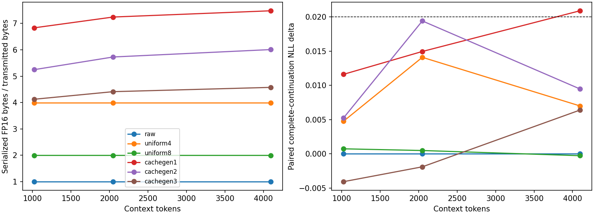
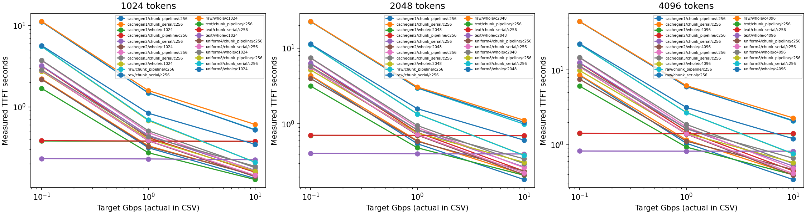
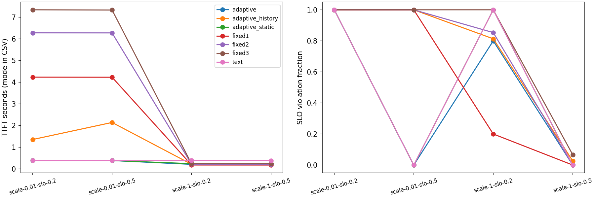
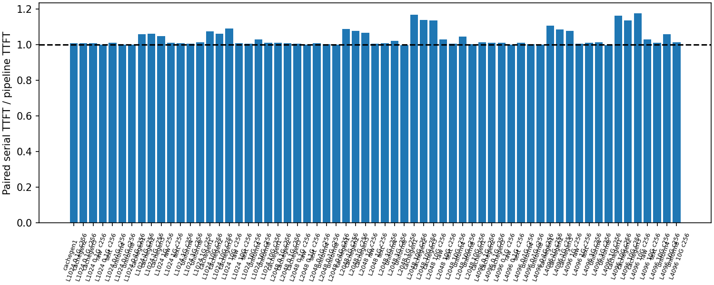
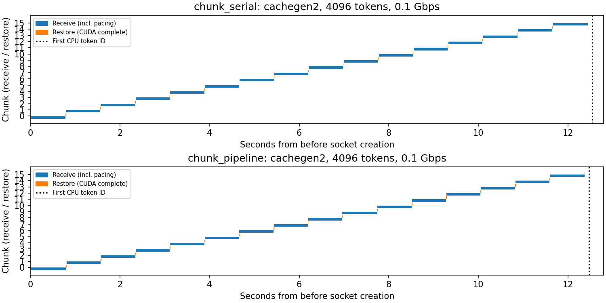

# mistral / larger / cachegen-shared-v3

Model: mistral-community/Mistral-7B-v0.2 @ 80cf49b18de6354fd8a6d1e81c177dd830e05eea; weights: fastchat8.

All 7 core tasks and 12594 expected observations verified. TriviaQA is supplementary inside the quality task.

## Protocol and limits

NLL scores every held-out token 1..N. The final context token is replayed against restored KV[0:L-1]; no historical v1 NLL is pooled. Negative ΔNLL alone does not show improved model quality.

QA is deterministic greedy decoding until EOS or the configured token limit. Raw generation and token IDs are retained. Leading LF characters are stripped, then only the first LF line is scored with standard normalized EM/F1 and predeclared dataset aliases. Controlled QA and TriviaQA are separate. Historical phrase matching is diagnostic only.

The per-length descriptive gate remains ΔNLL ≤0.02 and EM retention ≥90% of raw-correct controlled questions at that same length. With zero raw-correct questions the result is unassessable. No thresholds or aliases were tuned on results.

TTFT starts before socket setup and ends after the first generated token ID is available on CPU, including transfer, restore/tokenization, and remaining-input inference with CUDA synchronization. It excludes offline prefill/encoding, validation, and subsequent generation. Only the final required hidden state is projected to vocabulary for both text and cache methods. No network interface shaping is used.

Offline prefill and representation encoding are measured separately. Their durations are once-per-context annotations repeated on rows for traceability, not costs incurred on each timed transfer. Adaptive calibration additionally records all-level encoding and preparation wall time, including raw QA/warmups/validation; it is not a minimal production cache-build estimate.

Text wire format utf8_token_patch_v1 sends UTF-8 and explicit token-repair metadata for standalone subword boundaries or concatenated token segments. The receiver actually retokenizes and applies only the transmitted edits; all framing and token patches count in bytes. Patch counts are recorded. This is not an unmodified plain-text-only wire benchmark.

The independent whole-text reference retains its original optimized single context+suffix forward. Both chunk controls instead execute the same dependent context prefill per chunk, then suffix-only inference. Pipeline benefit is primarily evaluated against chunk serial with identical messages, not attributed from a whole/chunk comparison.

FP16 full-prefill and cache-reuse shapes can produce different greedy tokens at near-tied logits. cache_checks.json records actual IDs, first-divergence position and all reference-prefix logit comparisons. A nonidentical sequence is classified as numerical sensitivity only when its first divergent choices are within two FP16 representable steps and all vectors satisfy the existing atol=0.1/rtol=0.02 check; otherwise execution fails. Actual generations and QA/NLL scores are never repaired. Same-payload serial/pipeline tensors and generated IDs still require exact equality.

Text full-vs-chunk KV retains the strict elementwise atol=0.1/rtol=0.02 check. Per-head RMS and all elementwise outliers are additional diagnostics, never a substitute for the strict check. Stable execution uses fixed FP16 projection row tiles and explicit causal masks with the original efficient SDPA; all methods use the same execution settings and the final-position LM head remains untouched. Arithmetic calls use safe 96-token internal segments inside the existing <=256-token CUDA kernel, preventing rare 16-bit-CDF symbols from overflowing its 256-byte shared buffer. Actual segment sizes and their complete stream metadata count in bytes.

Execution settings (also checkpointed and fingerprinted): {"explicit_causal_mask": true, "fp16_reduced_precision_reduction": false, "linear_tile_tokens": 256, "sdpa_backend": "efficient"}. Results with automatic kernels and stable kernels are separate batches; execution scheduling can affect absolute timing.

Adaptive mode: socket_serial. Protocol v3 executes measured, serial paced socket transfers; it rejects trace_estimate for history feedback. SLO applies to TTFT; full answer latency is separate.

History throughput variant adaptive_history uses a fixed first-block estimate of 1.0 Gbps, then the previous completed full-message bytes * 8 / effective receive interval. The interval starts after receiver capacity/buffer readiness, includes pre-send pacing and socket overhead, and excludes queue-capacity and previous GPU waits. The history policy cannot access current or future trace values; those are executor inputs and posthoc diagnostics. Both adaptive variants share candidate costs, remaining budget, first-token reserve and fallback rules. This is a block-level trace simulation, not the complete paper scheduler.

Each adaptive cached chunk comes from a full original-context prefill, so later-layer KV retains original-prefix dependence. Text fallback actually recomputes on the assembled prior KV with explicit positions. This is the repository heuristic, not the paper scheduler. Adaptive execution is serial. TTFT separately compares whole, chunk serial and bounded chunk pipeline; anchor/delta coding is absent.

Byte ratios divide sums of actual serialized FP16 containers by sums of transmitted containers, including scales, CDFs, shapes and other metadata. Tensor-only ratios are separately named. Local socket target bandwidth is not measured throughput; see calibration.json and ttft.csv.

## Paired quality by length

| context_tokens | method | raw_serialized_over_method | paired_nll_delta | raw_em_correct | em_retention | acceptance |
| --- | --- | --- | --- | --- | --- | --- |
| 1024 | raw | 1 | 0 | 30 | 1 | pass |
| 1024 | uniform4 | 3.9843 | 0.0047643 | 30 | 1 | pass |
| 1024 | uniform8 | 1.9961 | 0.00073147 | 30 | 1 | pass |
| 1024 | cachegen1 | 6.8327 | 0.011615 | 30 | 1 | pass |
| 1024 | cachegen2 | 5.2472 | 0.0052458 | 30 | 1 | pass |
| 1024 | cachegen3 | 4.125 | -0.0040682 | 30 | 1 | pass |
| 2048 | raw | 1 | 0 | 30 | 1 | pass |
| 2048 | uniform4 | 3.9844 | 0.0141 | 30 | 1 | pass |
| 2048 | uniform8 | 1.9961 | 0.00048446 | 30 | 1 | pass |
| 2048 | cachegen1 | 7.2412 | 0.014954 | 30 | 1 | pass |
| 2048 | cachegen2 | 5.7264 | 0.019415 | 30 | 1 | pass |
| 2048 | cachegen3 | 4.4119 | -0.001898 | 30 | 1 | pass |
| 4096 | raw | 1 | 0 | 30 | 1 | pass |
| 4096 | uniform4 | 3.9844 | 0.007 | 30 | 1 | pass |
| 4096 | uniform8 | 1.9961 | -0.00027155 | 30 | 1 | pass |
| 4096 | cachegen1 | 7.4779 | 0.020898 | 30 | 1 | fail |
| 4096 | cachegen2 | 6.0076 | 0.0094805 | 30 | 1 | pass |
| 4096 | cachegen3 | 4.5744 | 0.0063918 | 30 | 1 | pass |

## Separate QA datasets

| dataset | method | independent_questions_or_facts | conditions | mean_em | mean_f1 |
| --- | --- | --- | --- | --- | --- |
| controlled | raw | 10 | 90 | 1 | 1 |
| controlled | uniform4 | 10 | 90 | 1 | 1 |
| controlled | uniform8 | 10 | 90 | 1 | 1 |
| controlled | cachegen1 | 10 | 90 | 1 | 1 |
| controlled | cachegen2 | 10 | 90 | 1 | 1 |
| controlled | cachegen3 | 10 | 90 | 1 | 1 |
| triviaqa | raw | 20 | 20 | 0.8 | 0.83333 |
| triviaqa | uniform4 | 20 | 20 | 0.75 | 0.78333 |
| triviaqa | uniform8 | 20 | 20 | 0.8 | 0.83333 |
| triviaqa | cachegen1 | 20 | 20 | 0.75 | 0.78333 |
| triviaqa | cachegen2 | 20 | 20 | 0.75 | 0.78333 |
| triviaqa | cachegen3 | 20 | 20 | 0.75 | 0.78333 |

## TTFT

| context_tokens | target_bandwidth_gbps | method | mode | chunk_size | timing_observations | median_seconds | mean_actual_bandwidth_gbps | speedup_vs_text |
| --- | --- | --- | --- | --- | --- | --- | --- | --- |
| 1024 | 0.1 | cachegen1 | chunk_pipeline | 256 | 50 | 2.1988 | 0.099713 | 0.17358 |
| 1024 | 0.1 | cachegen1 | chunk_serial | 256 | 50 | 2.2192 | 0.099731 | 0.17359 |
| 1024 | 0.1 | cachegen1 | whole | 1024 | 50 | 1.6918 | 0.099719 | 0.13711 |
| 1024 | 0.1 | cachegen2 | chunk_pipeline | 256 | 50 | 3.1789 | 0.099669 | 0.12006 |
| 1024 | 0.1 | cachegen2 | chunk_serial | 256 | 50 | 3.2068 | 0.099731 | 0.12013 |
| 1024 | 0.1 | cachegen2 | whole | 1024 | 50 | 2.1793 | 0.099609 | 0.10644 |
| 1024 | 0.1 | cachegen3 | chunk_pipeline | 256 | 50 | 3.7264 | 0.099698 | 0.10242 |
| 1024 | 0.1 | cachegen3 | chunk_serial | 256 | 50 | 3.7553 | 0.099704 | 0.10258 |
| 1024 | 0.1 | cachegen3 | whole | 1024 | 50 | 2.7435 | 0.099624 | 0.084552 |
| 1024 | 0.1 | raw | chunk_pipeline | 256 | 50 | 11.167 | 0.099072 | 0.034177 |
| 1024 | 0.1 | raw | chunk_serial | 256 | 50 | 11.174 | 0.099207 | 0.034477 |
| 1024 | 0.1 | raw | whole | 1024 | 50 | 11.264 | 0.099092 | 0.020595 |
| 1024 | 0.1 | text | chunk_pipeline | 256 | 50 | 0.38166 | 0.033722 | 1 |
| 1024 | 0.1 | text | chunk_serial | 256 | 50 | 0.38523 | 0.033033 | 1 |
| 1024 | 0.1 | text | whole | 1024 | 50 | 0.23197 | 0.061123 | 1 |
| 1024 | 0.1 | uniform4 | chunk_pipeline | 256 | 50 | 2.8179 | 0.099573 | 0.13544 |
| 1024 | 0.1 | uniform4 | chunk_serial | 256 | 50 | 2.8217 | 0.099593 | 0.13652 |
| 1024 | 0.1 | uniform4 | whole | 1024 | 50 | 2.8654 | 0.099016 | 0.080955 |
| 1024 | 0.1 | uniform8 | chunk_pipeline | 256 | 50 | 5.5373 | 0.099607 | 0.068926 |
| 1024 | 0.1 | uniform8 | chunk_serial | 256 | 50 | 5.539 | 0.099779 | 0.069548 |
| 1024 | 0.1 | uniform8 | whole | 1024 | 50 | 5.689 | 0.099053 | 0.040775 |
| 1024 | 1 | cachegen1 | chunk_pipeline | 256 | 50 | 0.31486 | 0.97084 | 1.2038 |
| 1024 | 1 | cachegen1 | chunk_serial | 256 | 50 | 0.33279 | 0.97495 | 1.1456 |
| 1024 | 1 | cachegen1 | whole | 1024 | 50 | 0.27353 | 0.96745 | 0.83933 |
| 1024 | 1 | cachegen2 | chunk_pipeline | 256 | 50 | 0.41982 | 0.97229 | 0.90283 |
| 1024 | 1 | cachegen2 | chunk_serial | 256 | 50 | 0.44705 | 0.97341 | 0.8528 |
| 1024 | 1 | cachegen2 | whole | 1024 | 50 | 0.32594 | 0.97353 | 0.70436 |
| 1024 | 1 | cachegen3 | chunk_pipeline | 256 | 50 | 0.48371 | 0.96977 | 0.78357 |
| 1024 | 1 | cachegen3 | chunk_serial | 256 | 50 | 0.50936 | 0.97373 | 0.74849 |
| 1024 | 1 | cachegen3 | whole | 1024 | 50 | 0.40365 | 0.95915 | 0.56877 |
| 1024 | 1 | raw | chunk_pipeline | 256 | 50 | 1.4851 | 0.91663 | 0.25522 |
| 1024 | 1 | raw | chunk_serial | 256 | 50 | 1.488 | 0.92739 | 0.25622 |
| 1024 | 1 | raw | whole | 1024 | 50 | 1.5896 | 0.9161 | 0.14443 |
| 1024 | 1 | text | chunk_pipeline | 256 | 50 | 0.37902 | 0.065926 | 1 |
| 1024 | 1 | text | chunk_serial | 256 | 50 | 0.38125 | 0.065516 | 1 |
| 1024 | 1 | text | whole | 1024 | 50 | 0.22958 | 0.14126 | 1 |
| 1024 | 1 | uniform4 | chunk_pipeline | 256 | 50 | 0.3834 | 0.96413 | 0.9886 |
| 1024 | 1 | uniform4 | chunk_serial | 256 | 50 | 0.38579 | 0.96751 | 0.98822 |
| 1024 | 1 | uniform4 | whole | 1024 | 50 | 0.43289 | 0.91025 | 0.53035 |
| 1024 | 1 | uniform8 | chunk_pipeline | 256 | 50 | 0.6814 | 0.9658 | 0.55624 |
| 1024 | 1 | uniform8 | chunk_serial | 256 | 50 | 0.69374 | 0.97791 | 0.54956 |
| 1024 | 1 | uniform8 | whole | 1024 | 50 | 0.83678 | 0.91206 | 0.27436 |
| 1024 | 10 | cachegen1 | chunk_pipeline | 256 | 50 | 0.13203 | 5.7499 | 2.8451 |
| 1024 | 10 | cachegen1 | chunk_serial | 256 | 50 | 0.14347 | 7.0558 | 2.6393 |
| 1024 | 10 | cachegen1 | whole | 1024 | 50 | 0.12805 | 7.4792 | 1.7525 |
| 1024 | 10 | cachegen2 | chunk_pipeline | 256 | 50 | 0.15741 | 5.8325 | 2.3864 |
| 1024 | 10 | cachegen2 | chunk_serial | 256 | 50 | 0.1661 | 7.4329 | 2.2797 |
| 1024 | 10 | cachegen2 | whole | 1024 | 50 | 0.14383 | 7.5922 | 1.5602 |
| 1024 | 10 | cachegen3 | chunk_pipeline | 256 | 50 | 0.16299 | 6.2904 | 2.3047 |
| 1024 | 10 | cachegen3 | chunk_serial | 256 | 50 | 0.17931 | 7.3833 | 2.1117 |
| 1024 | 10 | cachegen3 | whole | 1024 | 50 | 0.16229 | 6.9307 | 1.3828 |
| 1024 | 10 | raw | chunk_pipeline | 256 | 50 | 0.52598 | 5.1094 | 0.71417 |
| 1024 | 10 | raw | chunk_serial | 256 | 50 | 0.52113 | 5.5047 | 0.7266 |
| 1024 | 10 | raw | whole | 1024 | 50 | 0.60911 | 5.3047 | 0.36841 |
| 1024 | 10 | text | chunk_pipeline | 256 | 50 | 0.37564 | 0.07789 | 1 |
| 1024 | 10 | text | chunk_serial | 256 | 50 | 0.37866 | 0.069173 | 1 |
| 1024 | 10 | text | whole | 1024 | 50 | 0.22441 | 0.23446 | 1 |
| 1024 | 10 | uniform4 | chunk_pipeline | 256 | 50 | 0.13896 | 6.9289 | 2.7033 |
| 1024 | 10 | uniform4 | chunk_serial | 256 | 50 | 0.14453 | 7.0759 | 2.6199 |
| 1024 | 10 | uniform4 | whole | 1024 | 50 | 0.18621 | 5.0431 | 1.2051 |
| 1024 | 10 | uniform8 | chunk_pipeline | 256 | 50 | 0.20961 | 6.7258 | 1.7921 |
| 1024 | 10 | uniform8 | chunk_serial | 256 | 50 | 0.20857 | 7.7135 | 1.8155 |
| 1024 | 10 | uniform8 | whole | 1024 | 50 | 0.34718 | 5.1751 | 0.64636 |
| 2048 | 0.1 | cachegen1 | chunk_pipeline | 256 | 50 | 4.3035 | 0.099621 | 0.16381 |
| 2048 | 0.1 | cachegen1 | chunk_serial | 256 | 50 | 4.347 | 0.099663 | 0.16286 |
| 2048 | 0.1 | cachegen1 | whole | 2048 | 50 | 3.1547 | 0.098971 | 0.12937 |
| 2048 | 0.1 | cachegen2 | chunk_pipeline | 256 | 50 | 6.259 | 0.099613 | 0.11263 |
| 2048 | 0.1 | cachegen2 | chunk_serial | 256 | 50 | 6.3197 | 0.099627 | 0.11202 |
| 2048 | 0.1 | cachegen2 | whole | 2048 | 50 | 3.9649 | 0.099039 | 0.10294 |
| 2048 | 0.1 | cachegen3 | chunk_pipeline | 256 | 50 | 7.3649 | 0.099602 | 0.095721 |
| 2048 | 0.1 | cachegen3 | chunk_serial | 256 | 50 | 7.4141 | 0.099662 | 0.095487 |
| 2048 | 0.1 | cachegen3 | whole | 2048 | 50 | 5.1435 | 0.099091 | 0.079349 |
| 2048 | 0.1 | raw | chunk_pipeline | 256 | 50 | 22.3 | 0.098944 | 0.031613 |
| 2048 | 0.1 | raw | chunk_serial | 256 | 50 | 22.396 | 0.099118 | 0.031611 |
| 2048 | 0.1 | raw | whole | 2048 | 50 | 22.44 | 0.099052 | 0.018188 |
| 2048 | 0.1 | text | chunk_pipeline | 256 | 50 | 0.70497 | 0.03392 | 1 |
| 2048 | 0.1 | text | chunk_serial | 256 | 50 | 0.70796 | 0.033838 | 1 |
| 2048 | 0.1 | text | whole | 2048 | 50 | 0.40813 | 0.074389 | 1 |
| 2048 | 0.1 | uniform4 | chunk_pipeline | 256 | 50 | 5.5615 | 0.09932 | 0.12676 |
| 2048 | 0.1 | uniform4 | chunk_serial | 256 | 50 | 5.5779 | 0.099319 | 0.12692 |
| 2048 | 0.1 | uniform4 | whole | 2048 | 50 | 5.7024 | 0.099037 | 0.071572 |
| 2048 | 0.1 | uniform8 | chunk_pipeline | 256 | 50 | 11.052 | 0.099328 | 0.063789 |
| 2048 | 0.1 | uniform8 | chunk_serial | 256 | 50 | 11.06 | 0.099511 | 0.064009 |
| 2048 | 0.1 | uniform8 | whole | 2048 | 50 | 11.281 | 0.099069 | 0.03618 |
| 2048 | 1 | cachegen1 | chunk_pipeline | 256 | 50 | 0.54725 | 0.96725 | 1.2813 |
| 2048 | 1 | cachegen1 | chunk_serial | 256 | 50 | 0.59978 | 0.96708 | 1.1782 |
| 2048 | 1 | cachegen1 | whole | 2048 | 50 | 0.48354 | 0.91052 | 0.83624 |
| 2048 | 1 | cachegen2 | chunk_pipeline | 256 | 50 | 0.77147 | 0.96349 | 0.90887 |
| 2048 | 1 | cachegen2 | chunk_serial | 256 | 50 | 0.8317 | 0.962 | 0.84966 |
| 2048 | 1 | cachegen2 | whole | 2048 | 50 | 0.58836 | 0.91348 | 0.68725 |
| 2048 | 1 | cachegen3 | chunk_pipeline | 256 | 50 | 0.89448 | 0.96549 | 0.78388 |
| 2048 | 1 | cachegen3 | chunk_serial | 256 | 50 | 0.95013 | 0.96844 | 0.74375 |
| 2048 | 1 | cachegen3 | whole | 2048 | 50 | 0.75681 | 0.91513 | 0.53428 |
| 2048 | 1 | raw | chunk_pipeline | 256 | 50 | 2.9692 | 0.90618 | 0.23615 |
| 2048 | 1 | raw | chunk_serial | 256 | 50 | 2.9845 | 0.91725 | 0.23678 |
| 2048 | 1 | raw | whole | 2048 | 50 | 3.0696 | 0.92011 | 0.13173 |
| 2048 | 1 | text | chunk_pipeline | 256 | 50 | 0.70117 | 0.069417 | 1 |
| 2048 | 1 | text | chunk_serial | 256 | 50 | 0.70667 | 0.068122 | 1 |
| 2048 | 1 | text | whole | 2048 | 50 | 0.40435 | 0.22524 | 1 |
| 2048 | 1 | uniform4 | chunk_pipeline | 256 | 50 | 0.71129 | 0.94034 | 0.98577 |
| 2048 | 1 | uniform4 | chunk_serial | 256 | 50 | 0.72131 | 0.93924 | 0.97969 |
| 2048 | 1 | uniform4 | whole | 2048 | 50 | 0.83452 | 0.9136 | 0.48453 |
| 2048 | 1 | uniform8 | chunk_pipeline | 256 | 50 | 1.3544 | 0.9409 | 0.51771 |
| 2048 | 1 | uniform8 | chunk_serial | 256 | 50 | 1.3474 | 0.95928 | 0.52445 |
| 2048 | 1 | uniform8 | whole | 2048 | 50 | 1.5841 | 0.91724 | 0.25525 |
| 2048 | 10 | cachegen1 | chunk_pipeline | 256 | 50 | 0.18439 | 5.7537 | 3.7806 |
| 2048 | 10 | cachegen1 | chunk_serial | 256 | 50 | 0.21477 | 7.0411 | 3.2682 |
| 2048 | 10 | cachegen1 | whole | 2048 | 50 | 0.20996 | 4.9797 | 1.9079 |
| 2048 | 10 | cachegen2 | chunk_pipeline | 256 | 50 | 0.23852 | 5.7878 | 2.9226 |
| 2048 | 10 | cachegen2 | chunk_serial | 256 | 50 | 0.26998 | 6.9917 | 2.5998 |
| 2048 | 10 | cachegen2 | whole | 2048 | 50 | 0.23849 | 5.1028 | 1.6797 |
| 2048 | 10 | cachegen3 | chunk_pipeline | 256 | 50 | 0.26411 | 6.0395 | 2.6395 |
| 2048 | 10 | cachegen3 | chunk_serial | 256 | 50 | 0.29897 | 7.2245 | 2.3478 |
| 2048 | 10 | cachegen3 | whole | 2048 | 50 | 0.31149 | 5.1539 | 1.2861 |
| 2048 | 10 | raw | chunk_pipeline | 256 | 50 | 0.99219 | 4.8564 | 0.70259 |
| 2048 | 10 | raw | chunk_serial | 256 | 50 | 1.0491 | 5.2477 | 0.66906 |
| 2048 | 10 | raw | whole | 2048 | 50 | 1.1153 | 5.3391 | 0.35916 |
| 2048 | 10 | text | chunk_pipeline | 256 | 50 | 0.6971 | 0.078836 | 1 |
| 2048 | 10 | text | chunk_serial | 256 | 50 | 0.7019 | 0.072836 | 1 |
| 2048 | 10 | text | whole | 2048 | 50 | 0.40059 | 0.4275 | 1 |
| 2048 | 10 | uniform4 | chunk_pipeline | 256 | 50 | 0.2135 | 6.407 | 3.2651 |
| 2048 | 10 | uniform4 | chunk_serial | 256 | 50 | 0.22509 | 6.325 | 3.1184 |
| 2048 | 10 | uniform4 | whole | 2048 | 50 | 0.34555 | 5.1642 | 1.1593 |
| 2048 | 10 | uniform8 | chunk_pipeline | 256 | 50 | 0.38521 | 5.9449 | 1.8097 |
| 2048 | 10 | uniform8 | chunk_serial | 256 | 50 | 0.38406 | 7.2272 | 1.8276 |
| 2048 | 10 | uniform8 | whole | 2048 | 50 | 0.60969 | 5.2343 | 0.65704 |
| 4096 | 0.1 | cachegen1 | chunk_pipeline | 256 | 50 | 8.5093 | 0.099533 | 0.16577 |
| 4096 | 0.1 | cachegen1 | chunk_serial | 256 | 50 | 8.6216 | 0.09957 | 0.16511 |
| 4096 | 0.1 | cachegen1 | whole | 4096 | 50 | 6.1075 | 0.098993 | 0.13459 |
| 4096 | 0.1 | cachegen2 | chunk_pipeline | 256 | 50 | 12.451 | 0.099523 | 0.11329 |
| 4096 | 0.1 | cachegen2 | chunk_serial | 256 | 50 | 12.584 | 0.09958 | 0.11312 |
| 4096 | 0.1 | cachegen2 | whole | 4096 | 50 | 7.5539 | 0.099 | 0.10882 |
| 4096 | 0.1 | cachegen3 | chunk_pipeline | 256 | 50 | 14.623 | 0.099615 | 0.096463 |
| 4096 | 0.1 | cachegen3 | chunk_serial | 256 | 50 | 14.77 | 0.099593 | 0.09638 |
| 4096 | 0.1 | cachegen3 | whole | 4096 | 50 | 9.8836 | 0.099015 | 0.083171 |
| 4096 | 0.1 | raw | chunk_pipeline | 256 | 50 | 44.705 | 0.098778 | 0.031554 |
| 4096 | 0.1 | raw | chunk_serial | 256 | 50 | 44.719 | 0.09897 | 0.031832 |
| 4096 | 0.1 | raw | whole | 4096 | 50 | 44.9 | 0.098959 | 0.018308 |
| 4096 | 0.1 | text | chunk_pipeline | 256 | 50 | 1.4106 | 0.031144 | 1 |
| 4096 | 0.1 | text | chunk_serial | 256 | 50 | 1.4235 | 0.032514 | 1 |
| 4096 | 0.1 | text | whole | 4096 | 50 | 0.82203 | 0.083584 | 1 |
| 4096 | 0.1 | uniform4 | chunk_pipeline | 256 | 50 | 11.104 | 0.099163 | 0.12704 |
| 4096 | 0.1 | uniform4 | chunk_serial | 256 | 50 | 11.13 | 0.099328 | 0.1279 |
| 4096 | 0.1 | uniform4 | whole | 4096 | 50 | 11.343 | 0.099015 | 0.072472 |
| 4096 | 0.1 | uniform8 | chunk_pipeline | 256 | 50 | 22.076 | 0.099123 | 0.063898 |
| 4096 | 0.1 | uniform8 | chunk_serial | 256 | 50 | 22.074 | 0.099396 | 0.064487 |
| 4096 | 0.1 | uniform8 | whole | 4096 | 50 | 22.543 | 0.09902 | 0.036466 |
| 4096 | 1 | cachegen1 | chunk_pipeline | 256 | 50 | 1.0444 | 0.95813 | 1.3417 |
| 4096 | 1 | cachegen1 | chunk_serial | 256 | 50 | 1.1598 | 0.95936 | 1.2217 |
| 4096 | 1 | cachegen1 | whole | 4096 | 50 | 0.92749 | 0.90814 | 0.88192 |
| 4096 | 1 | cachegen2 | chunk_pipeline | 256 | 50 | 1.507 | 0.95515 | 0.92984 |
| 4096 | 1 | cachegen2 | chunk_serial | 256 | 50 | 1.6413 | 0.9571 | 0.86326 |
| 4096 | 1 | cachegen2 | whole | 4096 | 50 | 1.1147 | 0.90832 | 0.73382 |
| 4096 | 1 | cachegen3 | chunk_pipeline | 256 | 50 | 1.7263 | 0.96459 | 0.81173 |
| 4096 | 1 | cachegen3 | chunk_serial | 256 | 50 | 1.8662 | 0.96426 | 0.75924 |
| 4096 | 1 | cachegen3 | whole | 4096 | 50 | 1.4234 | 0.91092 | 0.57465 |
| 4096 | 1 | raw | chunk_pipeline | 256 | 50 | 6.099 | 0.89122 | 0.22975 |
| 4096 | 1 | raw | chunk_serial | 256 | 50 | 5.9932 | 0.90314 | 0.23642 |
| 4096 | 1 | raw | whole | 4096 | 50 | 6.1825 | 0.91419 | 0.1323 |
| 4096 | 1 | text | chunk_pipeline | 256 | 50 | 1.4013 | 0.065238 | 1 |
| 4096 | 1 | text | chunk_serial | 256 | 50 | 1.4169 | 0.065351 | 1 |
| 4096 | 1 | text | whole | 4096 | 50 | 0.81797 | 0.34924 | 1 |
| 4096 | 1 | uniform4 | chunk_pipeline | 256 | 50 | 1.3891 | 0.9234 | 1.0088 |
| 4096 | 1 | uniform4 | chunk_serial | 256 | 50 | 1.4009 | 0.94728 | 1.0114 |
| 4096 | 1 | uniform4 | whole | 4096 | 50 | 1.6376 | 0.91022 | 0.49949 |
| 4096 | 1 | uniform8 | chunk_pipeline | 256 | 50 | 2.7045 | 0.92416 | 0.51813 |
| 4096 | 1 | uniform8 | chunk_serial | 256 | 50 | 2.6929 | 0.94686 | 0.52616 |
| 4096 | 1 | uniform8 | whole | 4096 | 50 | 3.1566 | 0.91429 | 0.25913 |
| 4096 | 10 | cachegen1 | chunk_pipeline | 256 | 50 | 0.34029 | 5.0362 | 4.1063 |
| 4096 | 10 | cachegen1 | chunk_serial | 256 | 50 | 0.3975 | 6.4355 | 3.557 |
| 4096 | 10 | cachegen1 | whole | 4096 | 50 | 0.39463 | 4.8869 | 2.0709 |
| 4096 | 10 | cachegen2 | chunk_pipeline | 256 | 50 | 0.44554 | 5.3682 | 3.1362 |
| 4096 | 10 | cachegen2 | chunk_serial | 256 | 50 | 0.51649 | 6.6594 | 2.7376 |
| 4096 | 10 | cachegen2 | whole | 4096 | 50 | 0.46352 | 4.949 | 1.7631 |
| 4096 | 10 | cachegen3 | chunk_pipeline | 256 | 50 | 0.48023 | 5.8671 | 2.9097 |
| 4096 | 10 | cachegen3 | chunk_serial | 256 | 50 | 0.55845 | 6.6499 | 2.5319 |
| 4096 | 10 | cachegen3 | whole | 4096 | 50 | 0.57462 | 4.9776 | 1.4222 |
| 4096 | 10 | raw | chunk_pipeline | 256 | 50 | 2.0722 | 4.5081 | 0.67432 |
| 4096 | 10 | raw | chunk_serial | 256 | 50 | 2.1074 | 4.9386 | 0.67093 |
| 4096 | 10 | raw | whole | 4096 | 50 | 2.2824 | 5.1916 | 0.35806 |
| 4096 | 10 | text | chunk_pipeline | 256 | 50 | 1.3973 | 0.069395 | 1 |
| 4096 | 10 | text | chunk_serial | 256 | 50 | 1.4139 | 0.066879 | 1 |
| 4096 | 10 | text | whole | 4096 | 50 | 0.81723 | 0.58537 | 1 |
| 4096 | 10 | uniform4 | chunk_pipeline | 256 | 50 | 0.39021 | 5.8967 | 3.5809 |
| 4096 | 10 | uniform4 | chunk_serial | 256 | 50 | 0.41109 | 6.0152 | 3.4395 |
| 4096 | 10 | uniform4 | whole | 4096 | 50 | 0.65853 | 5.0522 | 1.241 |
| 4096 | 10 | uniform8 | chunk_pipeline | 256 | 50 | 0.75094 | 5.2007 | 1.8608 |
| 4096 | 10 | uniform8 | chunk_serial | 256 | 50 | 0.75779 | 6.0421 | 1.8659 |
| 4096 | 10 | uniform8 | whole | 4096 | 50 | 1.203 | 5.1308 | 0.67935 |

## Paired pipeline comparison (same bytes)

| context_tokens | target_bandwidth_gbps | method | chunk_size | paired_observations | median_paired_speedup | mean_pipeline_overlap_seconds |
| --- | --- | --- | --- | --- | --- | --- |
| 1024 | 0.1 | cachegen1 | 256 | 50 | 1.0077 | 0.022385 |
| 1024 | 0.1 | cachegen2 | 256 | 50 | 1.0078 | 0.027499 |
| 1024 | 0.1 | cachegen3 | 256 | 50 | 1.0073 | 0.028688 |
| 1024 | 0.1 | raw | 256 | 50 | 1.001 | 0.029104 |
| 1024 | 0.1 | text | 256 | 50 | 1.0093 | 0.0011121 |
| 1024 | 0.1 | uniform4 | 256 | 50 | 1.0009 | 0.0057459 |
| 1024 | 0.1 | uniform8 | 256 | 50 | 1.0007 | 0.013212 |
| 1024 | 1 | cachegen1 | 256 | 50 | 1.0576 | 0.021976 |
| 1024 | 1 | cachegen2 | 256 | 50 | 1.0609 | 0.027176 |
| 1024 | 1 | cachegen3 | 256 | 50 | 1.0485 | 0.030976 |
| 1024 | 1 | raw | 256 | 50 | 1.0118 | 0.025617 |
| 1024 | 1 | text | 256 | 50 | 1.0074 | 0.00057263 |
| 1024 | 1 | uniform4 | 256 | 50 | 1.0062 | 0.0053189 |
| 1024 | 1 | uniform8 | 256 | 50 | 1.0135 | 0.013312 |
| 1024 | 10 | cachegen1 | 256 | 50 | 1.0747 | 0.019343 |
| 1024 | 10 | cachegen2 | 256 | 50 | 1.0618 | 0.025175 |
| 1024 | 10 | cachegen3 | 256 | 50 | 1.0914 | 0.025877 |
| 1024 | 10 | raw | 256 | 50 | 1.0083 | 0.024813 |
| 1024 | 10 | text | 256 | 50 | 1.0061 | 0.00046117 |
| 1024 | 10 | uniform4 | 256 | 50 | 1.0293 | 0.0039984 |
| 1024 | 10 | uniform8 | 256 | 50 | 1.0107 | 0.012745 |
| 2048 | 0.1 | cachegen1 | 256 | 50 | 1.0115 | 0.050582 |
| 2048 | 0.1 | cachegen2 | 256 | 50 | 1.0086 | 0.060237 |
| 2048 | 0.1 | cachegen3 | 256 | 50 | 1.0066 | 0.066311 |
| 2048 | 0.1 | raw | 256 | 50 | 1.0012 | 0.060889 |
| 2048 | 0.1 | text | 256 | 50 | 1.0078 | 0.0026079 |
| 2048 | 0.1 | uniform4 | 256 | 50 | 1.0023 | 0.011726 |
| 2048 | 0.1 | uniform8 | 256 | 50 | 1.0005 | 0.023942 |
| 2048 | 1 | cachegen1 | 256 | 50 | 1.087 | 0.05229 |
| 2048 | 1 | cachegen2 | 256 | 50 | 1.0761 | 0.063628 |
| 2048 | 1 | cachegen3 | 256 | 50 | 1.0677 | 0.066992 |
| 2048 | 1 | raw | 256 | 50 | 1.0052 | 0.061302 |
| 2048 | 1 | text | 256 | 50 | 1.0084 | 0.0012669 |
| 2048 | 1 | uniform4 | 256 | 50 | 1.02 | 0.01173 |
| 2048 | 1 | uniform8 | 256 | 50 | 0.99602 | 0.023341 |
| 2048 | 10 | cachegen1 | 256 | 50 | 1.1672 | 0.044381 |
| 2048 | 10 | cachegen2 | 256 | 50 | 1.1377 | 0.054948 |
| 2048 | 10 | cachegen3 | 256 | 50 | 1.1353 | 0.060441 |
| 2048 | 10 | raw | 256 | 50 | 1.0304 | 0.056461 |
| 2048 | 10 | text | 256 | 50 | 1.0052 | 0.001127 |
| 2048 | 10 | uniform4 | 256 | 50 | 1.0455 | 0.0092537 |
| 2048 | 10 | uniform8 | 256 | 50 | 1.0022 | 0.020815 |
| 4096 | 0.1 | cachegen1 | 256 | 50 | 1.0128 | 0.11818 |
| 4096 | 0.1 | cachegen2 | 256 | 50 | 1.0106 | 0.14624 |
| 4096 | 0.1 | cachegen3 | 256 | 50 | 1.01 | 0.15358 |
| 4096 | 0.1 | raw | 256 | 50 | 1.0003 | 0.15257 |
| 4096 | 0.1 | text | 256 | 50 | 1.0111 | 0.0061163 |
| 4096 | 0.1 | uniform4 | 256 | 50 | 1.0016 | 0.039171 |
| 4096 | 0.1 | uniform8 | 256 | 50 | 0.99977 | 0.059571 |
| 4096 | 1 | cachegen1 | 256 | 50 | 1.1054 | 0.12289 |
| 4096 | 1 | cachegen2 | 256 | 50 | 1.0864 | 0.15118 |
| 4096 | 1 | cachegen3 | 256 | 50 | 1.0762 | 0.14913 |
| 4096 | 1 | raw | 256 | 50 | 1.0046 | 0.1561 |
| 4096 | 1 | text | 256 | 50 | 1.0113 | 0.0028823 |
| 4096 | 1 | uniform4 | 256 | 50 | 1.0143 | 0.037222 |
| 4096 | 1 | uniform8 | 256 | 50 | 0.99602 | 0.057508 |
| 4096 | 10 | cachegen1 | 256 | 50 | 1.1621 | 0.10449 |
| 4096 | 10 | cachegen2 | 256 | 50 | 1.1348 | 0.12592 |
| 4096 | 10 | cachegen3 | 256 | 50 | 1.1753 | 0.13738 |
| 4096 | 10 | raw | 256 | 50 | 1.028 | 0.13784 |
| 4096 | 10 | text | 256 | 50 | 1.0109 | 0.0026988 |
| 4096 | 10 | uniform4 | 256 | 50 | 1.0575 | 0.031687 |
| 4096 | 10 | uniform8 | 256 | 50 | 1.0144 | 0.049376 |

Pipeline speedup is serial/pipeline for each matched source, length, bandwidth, method, chunk size and repeat. Values below 1 mean slower pipeline. Chunk payload hashes and first tokens must match. Receiver capacity and send-permission waits, pacing, socket blocking, restoration, and overlap intervals are exported in ttft_timeline.csv / ttft_overlap.csv. All GPU restoration timestamps wait for CUDA completion.

## Adaptive configurations

| task | strategy | throughput_estimator | mode | fact_trace_conditions | timing_observations | median_ttft_seconds | slo_violation_rate | condition_mean_em | text_fallback_chunks |
| --- | --- | --- | --- | --- | --- | --- | --- | --- | --- |
| adaptive-scale-0.01-slo-0.2 | adaptive | current_trace | socket_serial | 25 | 75 | 0.38379 | 1 | 1 | 300 |
| adaptive-scale-0.01-slo-0.2 | adaptive_history | previous_completed_message | socket_serial | 25 | 75 | 1.3524 | 1 | 1 | 225 |
| adaptive-scale-0.01-slo-0.2 | adaptive_static | current_trace | socket_serial | 25 | 75 | 0.38393 | 1 | 1 | 300 |
| adaptive-scale-0.01-slo-0.2 | fixed1 | current_trace | socket_serial | 25 | 75 | 4.2314 | 1 | 1 | 0 |
| adaptive-scale-0.01-slo-0.2 | fixed2 | current_trace | socket_serial | 25 | 75 | 6.2733 | 1 | 1 | 0 |
| adaptive-scale-0.01-slo-0.2 | fixed3 | current_trace | socket_serial | 25 | 75 | 7.3364 | 1 | 1 | 0 |
| adaptive-scale-0.01-slo-0.2 | text | current_trace | socket_serial | 25 | 75 | 0.38409 | 1 | 1 | 300 |
| adaptive-scale-0.01-slo-0.5 | adaptive | current_trace | socket_serial | 25 | 75 | 0.38435 | 0 | 1 | 300 |
| adaptive-scale-0.01-slo-0.5 | adaptive_history | previous_completed_message | socket_serial | 25 | 75 | 2.1403 | 1 | 1 | 225 |
| adaptive-scale-0.01-slo-0.5 | adaptive_static | current_trace | socket_serial | 25 | 75 | 0.38343 | 0 | 1 | 300 |
| adaptive-scale-0.01-slo-0.5 | fixed1 | current_trace | socket_serial | 25 | 75 | 4.227 | 1 | 1 | 0 |
| adaptive-scale-0.01-slo-0.5 | fixed2 | current_trace | socket_serial | 25 | 75 | 6.2713 | 1 | 1 | 0 |
| adaptive-scale-0.01-slo-0.5 | fixed3 | current_trace | socket_serial | 25 | 75 | 7.3286 | 1 | 1 | 0 |
| adaptive-scale-0.01-slo-0.5 | text | current_trace | socket_serial | 25 | 75 | 0.38448 | 0 | 1 | 300 |
| adaptive-scale-1-slo-0.2 | adaptive | current_trace | socket_serial | 25 | 75 | 0.20809 | 0.8 | 1 | 30 |
| adaptive-scale-1-slo-0.2 | adaptive_history | previous_completed_message | socket_serial | 25 | 75 | 0.21008 | 0.81333 | 1 | 45 |
| adaptive-scale-1-slo-0.2 | adaptive_static | current_trace | socket_serial | 25 | 75 | 0.24006 | 1 | 1 | 30 |
| adaptive-scale-1-slo-0.2 | fixed1 | current_trace | socket_serial | 25 | 75 | 0.17778 | 0.2 | 1 | 0 |
| adaptive-scale-1-slo-0.2 | fixed2 | current_trace | socket_serial | 25 | 75 | 0.2172 | 0.85333 | 1 | 0 |
| adaptive-scale-1-slo-0.2 | fixed3 | current_trace | socket_serial | 25 | 75 | 0.23377 | 1 | 1 | 0 |
| adaptive-scale-1-slo-0.2 | text | current_trace | socket_serial | 25 | 75 | 0.38431 | 1 | 1 | 300 |
| adaptive-scale-1-slo-0.5 | adaptive | current_trace | socket_serial | 25 | 75 | 0.23575 | 0 | 1 | 0 |
| adaptive-scale-1-slo-0.5 | adaptive_history | previous_completed_message | socket_serial | 25 | 75 | 0.23248 | 0.026667 | 1 | 45 |
| adaptive-scale-1-slo-0.5 | adaptive_static | current_trace | socket_serial | 25 | 75 | 0.23338 | 0 | 1 | 0 |
| adaptive-scale-1-slo-0.5 | fixed1 | current_trace | socket_serial | 25 | 75 | 0.17642 | 0 | 1 | 0 |
| adaptive-scale-1-slo-0.5 | fixed2 | current_trace | socket_serial | 25 | 75 | 0.21198 | 0 | 1 | 0 |
| adaptive-scale-1-slo-0.5 | fixed3 | current_trace | socket_serial | 25 | 75 | 0.23179 | 0.066667 | 1 | 0 |
| adaptive-scale-1-slo-0.5 | text | current_trace | socket_serial | 25 | 75 | 0.38227 | 0 | 1 | 300 |

## Controlled mechanism ablations

| context_tokens | precision | entropy | mean_symbol_bits | mean_symbol_data_bytes | mean_complete_bytes | paired_nll_delta | mean_em | mean_encode_excluding_quantize_seconds | mean_decode_seconds |
| --- | --- | --- | --- | --- | --- | --- | --- | --- | --- |
| 1024 | layered2 | arithmetic | 4.1875 | 18212735 | 25559566 | 0.02447 | 1 | 0.036795 | 0.018852 |
| 1024 | layered2 | packed | 4.1875 | 35127296 | 35275859 | 0.02447 | 1 | 1.564 | 3.226 |
| 1024 | uniform16 | arithmetic | 4 | 16747593 | 21997198 | 0.034237 | 1 | 0.0273 | 0.015656 |
| 1024 | uniform16 | packed | 4 | 33554432 | 33702995 | 0.034237 | 1 | 1.5997 | 3.4946 |
| 1024 | uniform32 | arithmetic | 5 | 25171279 | 32518094 | -0.005704 | 1 | 0.039745 | 0.020209 |
| 1024 | uniform32 | packed | 5 | 41943040 | 42091603 | -0.005704 | 1 | 1.5905 | 3.6012 |

Each precision setting quantizes once; both entropy paths consume identical symbols/scales and share dequantization. Encoding timings exclude the separately recorded common quantization cost; complete sizes include CDF, stream lengths, scales, shapes and container overhead. uniform16 and uniform32 bracket layered2; differences in precision budget confound quality attribution. This small sweep shows size/quality tradeoffs, not isolated proof of layer allocation benefit.

## Statistical interpretation

2000 seeded source-cluster bootstrap draws; with few sources these are descriptive, not equivalence evidence

Independent documents/questions/facts, derived length/position/trace conditions and timing repeats are separately counted. Cluster intervals keep all conditions and repeats of a source together. Small-sample P95 is descriptive. A completed matrix establishes execution coverage, not paper-scale reproduction or statistical equivalence.

## Evidence

config.json, selection.json, metadata.json, preflight.json, cache_checks.json, ttft_checks.json, calibration.json, records.jsonl, events.jsonl, records.sqlite3, manifest.json, failures.jsonl (if any), dependencies.txt, hardware.txt, source/, artifacts.json, and run.log preserve the protocol, data, code, environment, order, outputs and checkpoints.

Resume: `bash experiments/run.sh --resume /home/aaa/CacheGen/results/mistral/larger/v3-larger-stable-20261025`. Integrity: `python3 -m experiments.suite --verify /home/aaa/CacheGen/results/mistral/larger/v3-larger-stable-20261025`.

## Figures

